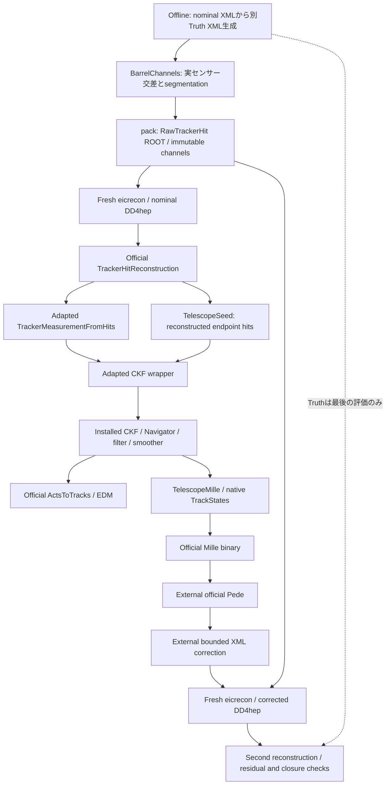

# Barrel alignment — コードと処理の対応表

実行の入口は [user guide](BARREL_ALIGNMENT_USER_GUIDE.md)。本書は実在ソースを読んだ
対応表であり、単にファイル名から推測した構成図ではありません。
baseline は EICrecon `195966d41899800eaeca6fbafd63cd53735e6543` の Git object です。
別 checkout の現在の HEAD や未コミット変更を公式 baseline として扱いません。

## 全体構成



### ディレクトリの役割

| 実在ディレクトリ | 役割と現在の位置づけ |
|---|---|
| `localDetEICrecon/` | 元の BeamTestReco と experimental plugin を保持。production plugin と新経路は別 target |
| `localDetEICrecon/experimental/barrel/` | 現行の opt-in EICrecon-style JANA chain、audit、CMake、provenance |
| `localDetEICrecon/experimental/barrel/algorithms/` | official measurement/CKF の限定コピーと telescope seed |
| `localDetEICrecon/experimental/barrel/factories/` | JOmniFactory による入力/出力依存の宣言。benchmark-only synthetic factory もここ |
| `localDetEICrecon/experimental/barrel/alignment/` | native TrackStates から公式 Mille に渡す observer と微分モデル |
| `localDetEICrecon/experimental/barrel/upstream_support/` | installation にない公式 collector header の変更なしコピー |
| `localDetEICrecon/experimental/barrel/upstream_diffs/` | pinned original に対する再生成可能な file-by-file patches。空 patch は同一内容 |
| `validation/barrel_geometry/` | physical barrel XML builder、metadata hook、official geometry/navigation/material audit |
| `validation/barrel_one_track/` | factory 化前の standalone one-track benchmark。現行 event processing の代用ではない |
| `validation/barrel_factories/` | minimal PODIO fixture、factory read-back comparison、upstream diff reproduction |
| `validation/barrel_alignment/` | derivative gates、native/legacy binary comparison、16-ray 数学 fixture、固定 label map |
| `validation/barrel_closure/` | 本 milestone の offline channels、stage orchestration、2-sensor correction、final validation |
| `localDetEICrecon/alignment/` | 元の BeamTestMilleWriter と tilt model。barrel native path は呼ばず、独立 crosscheck で再使用 |
| `localDetEICrecon/algorithms/`・`factories/`・`processors/`・`plugins/` | 元の digitization/reconstruction/Mille plugin。旧 production-like workflow を保全 |
| `geometry/` | 元の XML、placement/rigid-transform utilities、元経路の geometry preparation |
| `reconstruction/`・`alignment/`・`calibration/` | 元経路の独立 stages、Pede wrapper、delivery/geometry Controller。今回の barrel correction を制御しない |
| `environment/` | Docker wrapper、dependency pins/build。`external/` は生成された公式 dependency installation |
| `validation/` | unit/regression/safety と保全 manifests。historical result の照合はここ |
| `docs/` | 現行入口ガイドと各過去 milestone の技術報告 |
| `result/` | immutable-by-contract の stages、failed logs、ROOT/JSON/Mille/corrected XML。Git 対象外 |
| `build/` | 再生成可能な CMake outputs。Git 対象外。source として編集しない |

## module/source map

分類: **A** 公式を変更なし再使用、**B** 公式コピーを局所変更、**C** telescope 専用、
**D** 新 barrel chain では使わない旧経路/参照実装。
D は「不要・削除可能」の意味ではなく、元 workflow と regression を保つものです。
source paths は repository root からの相対パスです。

| 相対 source path | 主なクラス/関数、呼び出し元 | 入力 → 出力 | 分類・用途 |
|---|---|---|---|
| `localDetEICrecon/experimental/barrel/TelescopeTracking.cc` | `InitPlugin`、JOmniFactoryGeneratorT を登録 | JApplication/config → factories と collection contract | C、現行 JANA entry point |
| `localDetEICrecon/experimental/barrel/CMakeLists.txt` | TelescopeTracking、TestbenchBarrelMetadata、opt-in Mille targets | maintained sources + installed deps → .so/executables | C、build 必須 |
| `localDetEICrecon/experimental/barrel/FactoryAudit.h` | `FactoryAudit::Init/Process/Finish`、plugin が追加 | native ACTS + EDM/hits/measurements/seeds → audit JSON | C、validation observer。fit を変更しない |
| `localDetEICrecon/experimental/barrel/algorithms/tracking/TrackerMeasurementFromHits.{h,cc}` | `init/process`、measurement factory が実行 | TrackerHitCollection + services → Measurement2DCollection | B、現行変換 |
| `localDetEICrecon/experimental/barrel/factories/tracking/TrackerMeasurementFromHits_factory.h` | `Configure/Process`、InitPlugin が登録 | `TelescopeHits` → `TelescopeMeasurements` | B、現行 JANA boundary |
| `localDetEICrecon/experimental/barrel/algorithms/TelescopeSeed.h` | `TelescopeSeed::process`、seed factory が実行 | 5 endpoint-containing reconstructed hits → TrackSeed + TrackParameters | C、zero-field telescope beam seed |
| `localDetEICrecon/experimental/barrel/factories/TelescopeSeed_factory.h` | `Configure/Process` | `TelescopeHits` → `TelescopeSeeds`, `TelescopeSeedParameters` | C、現行 JANA boundary |
| `localDetEICrecon/experimental/barrel/algorithms/tracking/CKFTracking.{h,cc}` | `init/process`、CKF factory が実行 | TrackSeedCollection + Measurement2DCollection → native const state/track containers | B、現行 wrapper。installed finder を呼ぶ |
| `localDetEICrecon/experimental/barrel/algorithms/tracking/CKFTrackingConfig.h` | `CKFTrackingConfig` | parameter defaults → selector/fitter configuration | B、electronHypothesis を追加 |
| `localDetEICrecon/experimental/barrel/factories/tracking/CKFTracking_factory.h` | `Configure/Process` | seeds + measurements → `TelescopeActsStates`, `TelescopeActsTracks` | B、native outputs は PODIO collection ではない |
| `localDetEICrecon/experimental/barrel/extensions/edm4eic/EDM4eicToActs.h` | EDM/ACTS conversion helpers、copied CKF が include | EDM parameters → ACTS representations | A、installation 欠落 header を unchanged copy |
| `localDetEICrecon/experimental/barrel/upstream_support/algorithms/meta/CollectionCollector.h` | `CollectionCollector`、installed collector factory が include | empty input list → empty tracker association collection | A、unchanged pinned header。架空 MC を作らない |
| `localDetEICrecon/experimental/barrel/factories/SyntheticTrackerHits_factory.h` | `Process`、channelInput=false のときのみ登録 | fixed ray + current geometry/segmentation → TrackerHits + empty associations | C、one-event regression only。32-event closure の入力ではない |
| `localDetEICrecon/experimental/barrel/alignment/TelescopeMille.cc` | `InitPlugin`、`TelescopeMilleProcessor::Init/Process/Finish` | native ACTS states/tracks + Measurement2D + label map/gate → official Mille binary + JSON | C、現行 alignment observer |
| `localDetEICrecon/experimental/barrel/alignment/NativeMilleModel.{h,cc}` | `nativeEquation`, `requireDeterministicGeometry`, `rayMeasurement` | native bound reference + official surface/provider → prediction/local/global derivatives | C、現行数学。rayMeasurement は独立 FD 用 |
| `localDetEICrecon/experimental/barrel/provenance.json`、`localDetEICrecon/experimental/barrel/upstream_diffs/*.patch`、`localDetEICrecon/experimental/barrel/NOTICE.md`、`localDetEICrecon/experimental/barrel/LICENSE.LGPL3` | source hash/revision/diffs/license records | pinned official Git objects → audit trail | 現行 provenance、維持必須 |
| `validation/barrel_closure/closure.py` | `main`, `geometry_step`, `data_step`, `reconstruct`, `solve`, `correct`, `check`, `regressions` | source + config → staged fresh commands/results | C、外部 orchestration。Python で CKF を再実装しない |
| `validation/barrel_closure/BarrelChannels.cc` | `main` | XML + ray recipe/count → physical intersection/channel/sensor JSON | C、offline fixture generation と independent geometry audit |
| `validation/barrel_geometry/prepare.py` | `prepare` | maintained nominal XML → fresh barrel XML scenarios | C、現行 fixture 準備、production source XML は編集しない |
| `validation/barrel_geometry/BarrelMetadata.cc` | `initializeBarrelMetadata`, `DECLARE_APPLY` | real DD4hep hierarchy/axis args → flags/VariantParameters | C、XML initialization hook、runtime geometry 必須 |
| `validation/barrel_geometry/BarrelGeometryProbe.cc` | `main`, `experimentalMetadata`, `writeExclusive` | XML/provider mode → topology/material/navigation JSON | C、validation only。実行モードで metadata 操作有無を区別 |
| `validation/barrel_geometry/check.py` | `check`, `check_integration` | probe JSON + fixture → independent assertions | C、validation only |
| `validation/barrel_one_track/BarrelOneTrack.cc` | `main` | physical barrel + fixed pixel ray → standalone native CKF reference JSON | C、legacy benchmark/regression。JANA chain の外 |
| `validation/barrel_factories/prepare.py` | `main` | event identity → minimal EventHeader ROOT | C、benchmark fixture only。pinned writer finalization fix |
| `validation/barrel_factories/check.py` | `main` | audit/root + standalone reference → comparison JSON | C、one-event PODIO/native regression |
| `validation/barrel_factories/upstream_diff.py` | `main` | pinned Git source + manifest → fresh source patches | C、read-only upstream comparison、network 不要 |
| `validation/barrel_alignment/l1_l2_global_y.json` | validated parameter map | system/layer/axis/labels → processor scope guards | C、現行 L1/L2 only |
| `validation/barrel_alignment/BarrelMilleDerivatives.cc` | `main` | geometry + native audit or `geometry-center` → source-bound FD gate JSON | C、各 reconstruction の前に外部実行 |
| `validation/barrel_alignment/BarrelMilleFixture.cc` | `main` | geometry + native audit → separate 16-ray mathematical fixture/Pede steering | C、独立 regression only |
| `validation/barrel_alignment/LegacyBarrelCrosscheck.cc` | `main` | native audit → coordinate-adapted old writer Mille | C、validation only、旧 writer を数値比較 |
| `validation/barrel_alignment/check.py` | `records`, `profile`, `main` | binary rows/gates/legacy/fixture → Schur/rank/derivative comparison | C、独立 decoder と検証、official decoder も別途実行 |
| `research_common.py` | `execute/stage/done/require/digest` | argv + new stage paths → exclusive output/log/hash records | C、closure と旧 stages が共有する I/O/保全補助 |
| `geometry/transforms.py` | `matvec`, `transpose`, `RigidTransform`, rotation utilities | coordinates/matrices → rigid-transform calculations | C、barrel correction は matvec/transpose だけ再使用 |
| `localDetEICrecon/geometry/SurfacePlacements.h` | `surfacePlacements` | original DD4hep converter → array of 7 transforms | D、元 telescope placement bridge。新経路は official provider/surfaceMap |
| `localDetEICrecon/geometry/OfficialGeometryProbe.cc` | `main` | original XML/provider arguments → geometry probe report | D、元 geometry comparison/reference。barrel は別 probe |
| `calibration/geometry_manager.py` | `Geometries::register/review/activate` | original geometry candidates + evidence → registry/explicit activation | D、元 Controller の geometry lifecycle。barrel correct はここを使わない |
| `geometry/placements.py` | `geometry`, `placement_transforms` | original XML → parsed placement transforms | D、元 hierarchy utility、barrel 専用 XML adapter の代替ではない |
| `geometry/prepare.py` | `prepare`, `write_shifted_xml` | original endcap XML + explicit shifts/rotations → old workflow XML | D、production/reference path、今回の barrel correction には使わない |
| `alignment/align.py` | `read_pede`, `align` | official result text / steering → parsed parameters / external solve | C/D、read_pede は barrel で共有、align orchestration は元経路 |
| `localDetEICrecon/plugins/BeamTestReco.cc` | `InitPlugin` | original collections/config → original plugin factories/processors | D、保全する元 entry point |
| `localDetEICrecon/algorithms/digi/SiliconTrackerDigi.{h,cc}` と対応 Config/factory | `init/process` | original SimTrackerHits → raw channels/associations | D、元 digitization。今回の channels は offline 生成 |
| `localDetEICrecon/algorithms/tracking/TrackerHitReconstruction.{h,cc}` と対応 Config/factories | `process` | original raw channels → original reconstructed hits | D、元ローカルコピー。新 chain は installed official factory を使う |
| `localDetEICrecon/algorithms/tracking/BeamTestACTSFitter.{h,cc}` と対応 Config/factory | `init`, `fitSelected`, `process`, Calibrator/SurfaceAccessor | original hits → manually configured ACTS fit/EDM outputs | D、旧 fitter/面構築を維持。new chain は official Geometry/CKF |
| `localDetEICrecon/alignment/src/BeamTestMilleWriter.{h,cc}` | `writeTrackRecord`, `flush`, labelAx/labelAy | five Hit2D + configured axes/pivots → official Mille records | D、元 writer、barrel では LegacyBarrelCrosscheck からのみ呼ぶ |
| `localDetEICrecon/alignment/src/TiltMeasurementModel.h` | tilt measurement/whitening helpers | old plane axes + local line → old writer derivatives | D、tilt/SO(3) regression の参照、barrel validated scope ではない |
| `localDetEICrecon/processors/BeamTestMilleProcessor.{h,cc}`、`BeamTestEventProcessor.{h,cc}` | JANA processor lifecycle | original fit/event data → old Mille/event diagnostics | D、元 plugin が登録、新 plugin は使用しない |
| `calibration/controller.py` | `process`, `recover`, `main` | ready deliveries/queue + config → original per-file stages/geometry candidates | D、production-like prototype、barrel closure の外 |
| `reconstruction/reconstruct.py`、`reconstruction/runtime.py` | `reconstruct`, `runtime` | original input/config → BeamTestReco command/results | D、旧 workflow wrapper、new driver から呼ばない |
| `validation/verify_preservation.py` | module-level hash assertions | preserved/relocated/source/path manifests → PASS or assertion | C、両経路の保全 gate |
| `validation/check_safety.py`、`validation/test_*.py` | refusal checks、unittest cases | malformed/valid configs and fixtures → safety/regression logs | C、validation only |
| `environment/run.sh`、`setup_dependencies.py`、`dependencies.json` | container bridge、pinned build main | host argv/pins → container command / official dependency install | C、実行環境 |

対応 Config/factory の正確な既存パスは
`localDetEICrecon/algorithms/{digi,tracking}/*Config.h` と
`localDetEICrecon/factories/{digi,tracking}/`。歴史的 workflow の全 command 契約は
[WORKFLOW.md](WORKFLOW.md) と [calibration README](../calibration/README.md) を維持します。

## 公式 EICrecon との比較

以下の official path は pinned checkout 内の相対パスです。
インストール済みライブラリを新 chain の build に link し、公式 checkout 自体は変更しません。

| 分類・component | official → local、正確な変更と理由 | 互換性・交換条件 |
|---|---|---|
| A Geometry/services | `src/services/geometry/dd4hep/DD4hep_service.{h,cc}`、`src/services/geometry/acts/ACTSGeo_service.{h,cc}`、`src/services/algorithms_init/`、`src/algorithms/tracking/ActsGeometryProvider.{h,cc}` を installed のまま使用 | services が official TrackingGeometry/SurfaceMap を作る。独自 provider を挿し替えない |
| A TrackerHitReconstruction | `src/algorithms/tracking/TrackerHitReconstruction.{h,cc}` と `src/factories/tracking/TrackerHitReconstruction_factory.h` の unchanged installed `process` | RawTrackerHitCollection → TrackerHitCollection、real CellID decode と pitch/sqrt(12) を保持 |
| B measurement init | official `src/algorithms/tracking/TrackerMeasurementFromHits.{h,cc}::init` → `localDetEICrecon/experimental/barrel/algorithms/tracking/`。B0 constant の有無を先に調べ、存在時だけ読み特別 tolerance を適用 | telescope にない B0 constant を偽造しない。upstream が optional detector initialization を扱えば置換可能 |
| B measurement process | 同じ `process` に missing VolumeContext guard、system31/SiMAPSHits CartesianGridXZ 専用の covariance projection `J C J^T` を追加 | sensor X/Z covariance の xx/yy を ACTS u/v に射影。実際の軸では u=-sensor Z、v=sensor X。型は同一でも covariance semantics が違うため単純交換不可。unequal variance control を維持 |
| B measurement header/factory | official `.h` と `src/factories/tracking/TrackerMeasurementFromHits_factory.h` → 同名 local。optional B0 state、namespace telescope、include と AlgoT 参照を変更 | I/O は TrackerHitCollection → Measurement2DCollection のまま。factory wiring の変更であり別 fit algorithm ではない |
| C seeding | official `src/algorithms/tracking/TrackSeeding.{h,cc}`/factory は使わず `localDetEICrecon/experimental/barrel/algorithms/TelescopeSeed.h::process`/factory | official beamline seeding と telescope radial zero-field beam は前提が異なる。型は TrackSeed/TrackParameters だが、reference・beam prior を満たす場合だけ代替可能 |
| B CKF init/header | official `src/algorithms/tracking/CKFTracking.{h,cc}` → `localDetEICrecon/experimental/barrel/algorithms/tracking/`。namespace/includes、installed interface の alias、official `makeCKFTrackingFunction` 呼び出し | CKF implementation はコピーせず installed `src/algorithms/tracking/CKFTrackingFunction.cc` 相当を再使用。filter/Navigator/smoother の変更なし |
| B CKF process | official `CKFTracking::process` の origin perigee を各 `TrackSeed.getPerigee()` に変更し、output extrapolation も同じ seed reference にする | parameter reference convention を修正。EDM/native I/O 型は不変。upstream が seed reference を尊重するまでは交換不可 |
| B CKF config/factory | `CKFTrackingConfig.h` と `src/factories/tracking/CKFTracking_factory.h` → local 同名。`electronHypothesis=false` と parameter ref を追加、plugin は true を明示 | official pion default を保存。telescope electron prior にだけ electron を選択。particle hypothesis は物理上意味があり単なる名称変更ではない |
| A ActsToTracks | `src/algorithms/tracking/ActsToTracks.{h,cc}` と `src/factories/tracking/ActsToTracks_factory.h::Process` を unchanged reuse | measurements/seeds/native containers/empty hit associations → EDM trajectory/parameters/tracks/links/associations。native containers 自体を PODIO 化するわけではない |
| C DD4hep metadata | `validation/barrel_geometry/BarrelMetadata.cc::initializeBarrelMetadata` は telescope XML hook | 実 Tube layer envelopes に VariantParameters、sensitive descendants に axis_definitions、detector に TRACKER/BARREL flags。volumes/ACTS surfaces をここで捏造しない |
| A helper headers | `src/extensions/edm4eic/EDM4eicToActs.h`、`src/algorithms/meta/CollectionCollector.h` は unchanged copies | installation に header がないため。installation が揃えば include path を標準化可能 |
| C JANA registration | `src/global/tracking/tracking.cc` の generator registration 形式を `localDetEICrecon/experimental/barrel/TelescopeTracking.cc::InitPlugin` で telescope collections に適用 | official JOmniFactory/JOmniFactoryGeneratorT を unchanged 使用。collection 名と型の両方が契約 |
| D original BeamTestReco | 元ローカル fitter/writer/Controller を保存 | 新 chain で使わない。original endcap hierarchy と labels を barrel と混同しない |

namespace/includes、factory AlgoT、config/header の全行差分は保存済み9 patchesを正とします。
29 reviewed source hashes を今回 pinned Git object と照合し、9 patches を再生成して byte 一致を確認しました。
再生成コマンドは [factory report](BARREL_FACTORY_RECONSTRUCTION.md#source-comparison) の
該当記述、または次の形です：

```bash
# WRITES OUTPUT; upstream は読み取りのみ。出力は新規名にする。
python3 validation/barrel_factories/upstream_diff.py \
  --source /Users/tkumaoka/eic/EICrecon --output result/barrel_upstream_review_fresh
```

## 実際の JANA collection 接続と実行順序

`localDetEICrecon/experimental/barrel/TelescopeTracking.cc::InitPlugin` が次の dependencies を登録します。
JANA は単なる登録順ではなく、processor が要求した出力の依存をたどって factory を実行します。
`FactoryAudit::Process` と `TelescopeMilleProcessor::Process` が output を要求する consumer です。
`channelInput=true`、`multipleEvents=true` は closure driver の明示的 opt-in です。

1. **外部 geometry/data**: `closure.py::geometry_step` が `prepare(..., initialize_metadata=True)`
   で fresh nominal XML を作り、`displaced_xml` が別 Truth XML に L1/L2 を移動。
   `data_step` は `BarrelChannels::main` を別プロセスで実行。実 `VolumeContext` の
   local/world transform、plane intersection、CartesianGridXZ `cellID` で5センサーを量子化。
   `pack` は EventHeader と `TelescopeChannels`（RawTrackerHitCollection）だけを ROOT に入れます。
   position/direction/Truth は別 JSON に残り、JANA 入力にはありません。
2. **eicrecon 内**: official TrackerHitReconstruction factory は `TelescopeChannels` →
   `TelescopeHits`。RawHit relations を保つ。installed collector は入力なしで空の
   `TelescopeHitAssociations` を作ります。
3. **eicrecon 内**: adapted measurement factory は `TelescopeHits` → `TelescopeMeasurements`
   （Measurement2D）。各 measurement は hit relation、surface geometry ID、loc/covariance を持つ。
4. **eicrecon 内**: TelescopeSeed factory は `TelescopeHits` → `TelescopeSeeds` と
   `TelescopeSeedParameters`。5 hits の最初/最後から outward direction を計算、Global X=249 mm
   まで外挿した位置を seed perigee にします。q/p=-1 GeV^-1、1 GeV electron は beam prior。
5. **eicrecon 内**: adapted CKF factory は `TelescopeSeeds` + `TelescopeMeasurements` →
   `TelescopeActsStates`（Acts::ConstVectorMultiTrajectory）と
   `TelescopeActsTracks`（Acts::ConstVectorTrackContainer）。installed CKF function が
   official TrackingGeometry/Navigator を使い filter/smoothing。7面のうち測定はSiMAPS 5面。
6. **eicrecon 内**: unchanged ActsToTracks factory は measurements/seeds/native containers/empty
   associations を入力し、`TelescopeTrajectories`、`TelescopeTrackParameters`、`TelescopeTracks`、
   EDM version 条件付き `TelescopeTrackLinks`、`TelescopeTrackAssociations` を出す。
   PODIO output processor が指定 EDM collections を `reco.root` に保存する。
7. **eicrecon 内**: TelescopeMille observer は native containers と measurements を受け、
   accepted event ごとに公式 MilleRecord を1件 append。Audit/Mille は mutex を持ちますが、
   再現 command は `-Pnthreads=1`。新しい concurrency validation は主張しません。
8. **外部 solve**: `closure.py::solve` が `external/install/bin/pede` を呼ぶ。
   `profile` の独立 Schur 解は検証だけで、適用補正の代替 solver にはしない。
9. **外部 correction**: `correct` が actual Pede text と nominal XML だけを読み、別 corrected XML
   と provenance、実 Geometry audit を生成。**Truth は読まない。**
10. **fresh eicrecon**: `reconstruct(..., name='corrected')` が別 OS process を起動し
    DD4hep/TrackingGeometry/SurfaceMap を再構築。同じ shifted.root を再 decode/reconstruct。
11. **外部 validation**: postsolve、control/controlsolve、`check` の絶対座標 GLS/whitelist/
    channel hashes/EDM links/seed/covariance/residual/ROOT read-back を実行。
    offline Truth を見るのはこの最終物理比較であり、alignment inference ではありません。

## Alignment と Geometry 更新

### native measurements から Mille へ

`TelescopeMilleProcessor::Process` は native track の measurement states を pathLength 順に
並べ、最初の smoothed state を bound reference にします。SourceLink を
`ActsExamples::IndexSourceLink` に戻し、その index で `TelescopeMeasurements` を参照。
Measurement2D の単一 hit relation → TrackerHit CellID → official converter の VolumeID →
official `surfaceMap()` の surface をたどります。state の referenceSurface、measurement の
surface ID、SourceLink の GeometryIdentifier、derivative gate のIDが同じであることを検証します。
CellID、VolumeID、closed ACTS GeometryIdentifier は役割が異なり、同一数値と仮定しません。

`NativeMilleModel::nativeEquation` は official provider の contexts/field/geometry に対して
ACTS EigenStepper/Navigator propagation を使い、reference→measurement transportJacobian の
先頭2行・local parameters (loc0,loc1,phi,theta) の4列を取ります。
`Surface::alignmentToBoundDerivative` は surface placement に対する微分です。
ACTS local right rotation を physical Global left increment に写す `R^T` も実装されていますが、
現在 enabled/validated な alignment parameters は translation の Global Y 2つだけです。
この6列を計算することは任意6-DOF closure の検証を意味しません。
field/material/q/p-time sensitivity guards は対応外の条件を拒否します。

residual は **measured − prediction**。
linear equation は `residual ≈ localJacobian * localDelta + globalJacobian * alignmentDelta`。
calibrated measurement covariance `C=L L^T` の Cholesky から `W=L^-1` を作り、residual と
両 Jacobian を W で whitening、scalar sigma=1 で official MilleRecord に渡します。
smoothed residual covariance を measurement error に使わず、seed prior の行も書きません。
各 track の4 local parameters は Pede で消去され、shared labels 700102/700202 だけを解きます。
label map と runtime guards は system31、L1/L2、physical Global Y（mm）しか認めません。
L0/L3/L4 と2未測定面を固定し、基準自由度を保持します。

旧 `BeamTestMilleWriter::writeTrackRecord` は five Hit2D と独自の straight-line/pivot/axis
設定から式を作る元実装です。native state/SourceLink/official SurfaceMap は必要としません。
`LegacyBarrelCrosscheck` は座標を対応させた独立等価性試験であり、旧 writer を実 JANA-native
alignment inference に差し替えているわけではありません。

### chi2 と NDF を混同しない

- **ACTS CKF chi2**: 実際の filter/selection と seed prior を含む native tracking の値。
- **ACTS stored NDF**: この出力では各 track 10（2座標×5測定）、sum=320。
- **Mille/Pede profiled measurement chi2**: 元測定 covariance で whitening し、4 locals を
  freely profile した residual model。seed prior 行を含まない。
- **Pede statistical NDF**: 32×(10−4)−2=190。320 と同じ定義ではありません。

有限 seed prior と linearization/numerical effects のため ACTS chi2 sum と Pede chi2 は
厳密に同じではありません。corrected ACTS chi2/320≈0.690849 と Pede chi2/190≈1.163519 は
同時に成立し、誤差 rescaling の根拠として一方を他方に合わせません。

### 実際の XML correction

`validation/barrel_closure/closure.py::correct` → `alignment.align.read_pede` で
`solve/millepede.res` を読み、700102→layer1、700202→layer2 と明示対応します。
`displaced_xml` は `MODULE_TO_GLOBAL` の transpose を `geometry.transforms.matvec/transpose`
に渡して Global Y を module-local placement に変換。実 frame は module X=-Global Y、
module Y=-Global Z、module Z=Global X なので、+Global Y は sensitive component の−module X。
Pede parameter の符号を反転解釈しているわけではありません。
対象 module を layer ごとに clone し、selected sensitive component の position と layer の
module reference だけを更新。rotations、materials、segmentation、encoding、非対象 placement は
whitelist で保全します。corrected XML は source nominal と別ファイルです。

元 Controller は endcap/ring hierarchy、既存 labels と activation state を前提にしています。
今回そこを改造せず、2面1軸の bounded adapter に限定します。既存 rigid-transform/Pede parser
を再使用し、parallel generalized Controller は追加しません。
Truth、Nominal、Corrected の3 XML は独立し、fresh process が corrected XML を読むまで
既存 geometry は変わりません。同じ ROOT channel bytes と canonical CellID/charge/time/
EventHeader payload を nominal/corrected 前後で検証し、元データを補正で書き換えません。

## 保全・再現・残された課題

本 milestone のレビュー/再実行の実測記録は [validation record](BARREL_ALIGNMENT_VALIDATION.md)。
入口 guide は [user guide](BARREL_ALIGNMENT_USER_GUIDE.md) です。
各過去段階の原本は [readiness](BARREL_RECONSTRUCTION_READINESS.md)、
[factory](BARREL_FACTORY_RECONSTRUCTION.md)、[native Mille](BARREL_NATIVE_MILLE_INTEGRATION.md)、
[channel closure](BARREL_CHANNEL_ALIGNMENT_CLOSURE.md)。

元 source、99-track 結果と他の歴史結果を保全し、production branch を変更していません。
現在の two-translation・zero-field・material-free sample の成功を、磁場/物質、一般6-DOF、
real beam/electronics、大規模 campaign、statistical coverage、production activation の成功に
拡張解釈しないでください。将来は upstream の必要条件を一つずつ満たしてから、対応する
patch を削除し、同じ channel closure と anisotropic covariance/legacy/保全 gates を再実行します。
