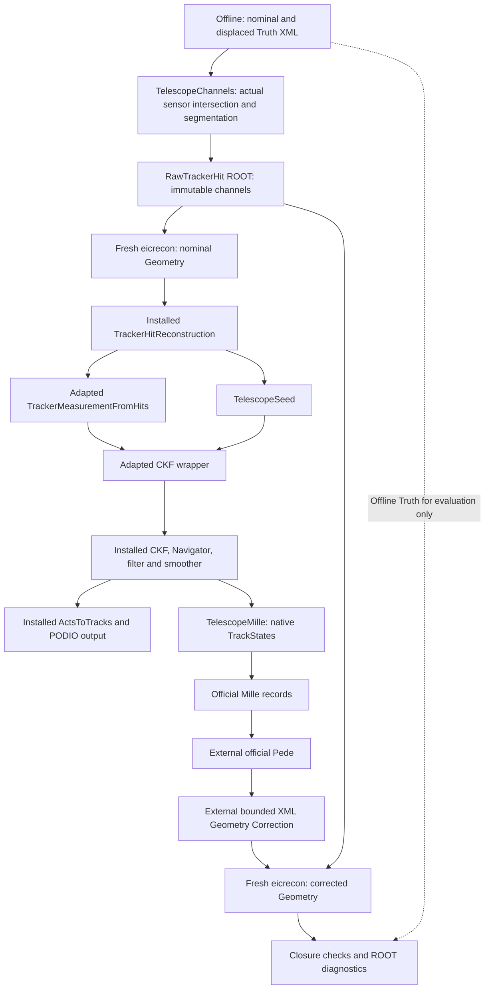

# Telescope alignment: source and processing map

Start with the [user guide](TELESCOPE_ALIGNMENT_USER_GUIDE.md).
This map describes the actual opt-in telescope chain. It is distinct from the
production/reference BeamTestReco path and from standard ePIC reconstruction.
Official source comparisons use pinned EICrecon Git objects at
`195966d41899800eaeca6fbafd63cd53735e6543`, not the external checkout's current HEAD.

## Directory roles

| Directory | Role |
|---|---|
| `localDetEICrecon/experimental/telescope/` | JANA plugins, adapted official modules, telescope producers, provenance and patches |
| `validation/telescope_geometry/` | barrel-compatible telescope XML builder, technical metadata hook, geometry/navigation audit |
| `validation/telescope_one_track/` | independent standalone native CKF reference; not the event-processing path |
| `validation/telescope_factories/` | one-event PODIO fixture, EDM read-back, upstream patch regeneration |
| `validation/telescope_alignment/` | derivative gate, native/legacy comparison, mathematical Mille fixture and label map |
| `validation/telescope_closure/` | offline channels, bounded two-translation XML correction, stage driver and final validation |
| `localDetEICrecon/alignment/` | preserved historical BeamTestMilleWriter, used only for independent equivalence checks here |
| `geometry/`, `reconstruction/`, `alignment/`, `calibration/` | original stages and Python Controller; not replaced or activated |
| `environment/` | fixed Docker bridge and external dependency setup |
| `result/`, `build/` | ignored execution artifacts; historical names remain unchanged |

## Actual processing flow



## Source, principal function and execution boundary

Paths below are relative to the repository root. `T/` means
`localDetEICrecon/experimental/telescope/`, `V/` means `validation/`.

| Source | Principal function / role | Execution |
|---|---|---|
| `V/telescope_geometry/prepare.py` | `prepare`: independent XML fixtures, real modules, metadata declarations | external Python |
| `V/telescope_geometry/BarrelMetadata.cc` | `initializeBarrelMetadata`: Tube layer metadata, sensor axis definitions, actual tracker/barrel flags | DD4hep XML initialization in each geometry process |
| `V/telescope_closure/TelescopeChannels.cc` | `main`: actual VolumeContext transforms, ray/sensor intersection, segmentation and ID checks | separate offline executable |
| `V/telescope_closure/closure.py` | `geometry_step`, `data_step`, `pack`: Truth XML and RawTrackerHit ROOT, separate Truth JSON | external Python |
| `T/TelescopeTracking.cc` | `InitPlugin`: JOmniFactoryGeneratorT collection wiring | eicrecon |
| installed `factories/tracking/TrackerHitReconstruction_factory.h` | official algorithm `process`: channels to TrackerHit, pitch/sqrt(12) errors and RawHit relations | eicrecon |
| `T/algorithms/tracking/TrackerMeasurementFromHits.{h,cc}` | `init`, `process`: SurfaceMap association, local Measurement2D and covariance | eicrecon |
| `T/factories/tracking/TrackerMeasurementFromHits_factory.h` | adapted official factory contract | eicrecon |
| `T/algorithms/TelescopeSeed.h`, `T/factories/TelescopeSeed_factory.h` | `process`: first/last reconstructed hits, outward direction and seed perigee at X=249 mm | eicrecon |
| `T/algorithms/tracking/CKFTracking.{h,cc}`, `CKFTrackingConfig.h`, corresponding factory | `init`, `process`: seed reference and hypothesis adapter to installed CKF | eicrecon |
| installed `ActsToTracks` and factory | native states/tracks to EDM trajectories, parameters, tracks and relations | eicrecon |
| `T/upstream_support/algorithms/meta/CollectionCollector.h` | official unchanged empty subset collector, no Truth association input | eicrecon |
| `T/FactoryAudit.h` | `Process`, `Finish`: actual native and EDM consistency, event diagnostics | eicrecon observer |
| `T/alignment/TelescopeMille.cc` | `TelescopeMilleProcessor::Process`, `Finish`: native measurement states to one Mille record per accepted track | eicrecon observer |
| `T/alignment/NativeMilleModel.{h,cc}` | `nativeEquation`: real ACTS propagation and transport/alignment derivatives | called inside observer and external derivative tests |
| `V/telescope_alignment/TelescopeMilleDerivatives.cc` | `main`: analytical/finite-difference gates on actual surfaces | external executable |
| `V/telescope_alignment/l1_l2_global_y.json` | labels 700102/700202 and explicit supported physical Global Y scope | observer configuration |
| `V/telescope_closure/closure.py` | `solve`: official Pede execution and independent Schur comparison | external Python/Pede |
| same | `correct`, `displaced_xml`: Pede text + nominal XML to separate corrected XML, no Truth | external Python |
| same | `reconstruct`: new OS process for each nominal/corrected/control pass | launches eicrecon |
| same | `check`: immutable channels, XML whitelist, data-only GLS, final Truth comparison and ROOT | external Python/PyROOT |
| same | `regressions`: 18 independent commands with separate logs and fresh reference builds | external driver |
| `V/telescope_one_track/TelescopeOneTrack.cc` | `main`: standalone native CKF benchmark | validation only |
| `V/telescope_factories/prepare.py`, `check.py` | minimal PODIO event and native/EDM reference comparison | validation only |
| `V/telescope_alignment/LegacyTelescopeCrosscheck.cc` | `main`: original writer in equivalent coordinates | validation only |
| `V/telescope_alignment/TelescopeMilleFixture.cc` | `main`: separate 16-ray mathematical fixture | validation only |
| `T/factories/SyntheticTrackerHits_factory.h` | benchmark-only synthetic producer; default original one-event path | validation only |

The dependency graph, not factory registration order, controls JANA execution.
Audit and Mille observers request the output collections. Channel closure explicitly
sets `channelInput=true` and both observers' `multipleEvents=true`; the default
one-event benchmark remains independent. Reproducible commands use one thread.

## Official versus local

| Category | Components and reasons |
|---|---|
| Reused unchanged, installed | DD4hep_service, ACTSGeo_service, ActsGeometryProvider, DD4hep converter, TrackingGeometry, SurfaceMap; TrackerHitReconstruction factory/algorithm; actual CKFTrackingFunction with EigenStepper/Navigator/filter/smoother; ActsToTracks; JOmniFactory/JOmniFactoryGeneratorT |
| Unchanged pinned header copies | `extensions/edm4eic/EDM4eicToActs.h` and `upstream_support/algorithms/meta/CollectionCollector.h`; installation lacks these headers. Replace with installed includes when provided and regression-tested |
| Official measurement copy, locally modified | optional B0 constant lookup avoids inventing an absent detector; missing VolumeContext guard; system31/SiMAPSHits CartesianGridXZ covariance projection maps packed sensor X/Z variances into ACTS u/v through J C J^T. Upstream needs equivalent optional detector handling and covariance semantics before direct replacement |
| Official CKF wrapper copy, locally modified | namespace/includes and installed interface adaptation; each seed's perigee is honored instead of assuming origin; electronHypothesis option defaults false, explicitly true for this telescope. Installed numerical CKF is reused. Replace when upstream respects the same seed reference and particle hypothesis |
| Telescope-specific | collection wiring, metadata hook, reconstructed-endpoint seed, native Mille observer, offline channel fixture, bounded two-sensor correction and validation |
| Historical/reference | BeamTestReco, BeamTestACTSFitter, BeamTestMilleWriter, tilt/SO(3) model, original stages/Controller. Preserved unchanged; the new native chain does not substitute these for official tracking |

Official seeding assumes beamline/circle-curvature information and cannot directly
supply this radial, zero-field telescope seed. `TelescopeSeed` is a deliberately
small adaptation, not a new fitter. q/p=-1/GeV is a 1 GeV electron beam prior,
not a measured momentum. Replacing a module requires matching coordinates,
covariance, hypothesis, reference surface and collection contracts, not just types.

Provenance, licenses and reproducible patches live under `T/`. Regenerate patches
using the read-only upstream Git checkout and a new output directory:

```bash
python3 validation/telescope_factories/upstream_diff.py \
  --source /Users/tkumaoka/eic/EICrecon --output result/telescope_upstream_review_fresh
```

The checkout path is an explicit local argument, not a build dependency. Compare
the generated files with `localDetEICrecon/experimental/telescope/upstream_diffs/`.

## Measurement equations and Geometry Correction

The actual native TrackState SourceLink indexes Measurement2D; its hit relation
leads to CellID, converter VolumeID and official SurfaceMap. VolumeID and closed
ACTS GeometryIdentifier are checked for consistency and are not assumed identical.
The earliest accepted smoothed state supplies the common bound reference.
`nativeEquation` repropagates with ACTS, takes transport derivatives for four local
parameters (loc0,loc1,phi,theta), and uses Surface::alignmentToBoundDerivative
including path correction. Local right rotation increments map to Global left
increments through R^T, but only the two Global Y translations are enabled here.

The equation is measured-minus-prediction = A*localDelta + G*alignmentDelta.
Whitening uses the original calibrated covariance C=L L^T and W=L^-1 for residual
and both Jacobians; official Mille receives scalar sigma=1. Smoothed covariance
is not substituted for measurement errors, and no seed-prior equations are added.
Pede profiles four local parameters per track and solves two shared labels.
Nonzero field, assigned material and observable q/p/time contributions are guarded
as unsupported. Derivative validation alone does not establish general six-DOF closure.

`correct` reuses `alignment.align.read_pede`; `displaced_xml` reuses
`geometry.transforms.matvec/transpose` to map physical Global Y into module axes.
Only selected module references and sensitive-component translations change; all
other XML attributes/text are whitelisted. Same channel bytes are decoded again
in a fresh process. No Controller registry or Geometry activation is involved.
The historical writer remains an independent straight-line equivalence reference.

ACTS stored NDF counts measured dimensions (10 per track). Pede statistical NDF
is 32*(10-4)-2=190. Native CKF includes the seed prior; profiled Pede does not.
Their chi2 values and denominators therefore have distinct meanings. No covariance
rescaling or uncertainty-coverage claim follows from the successful closure.

## Historical terminology

Historical `BARREL_*` report filenames and `result/barrel_*` directories record
past executions and remain intact. Their old source commands refer to that revision;
this guide and code map provide current paths. Technical names retained include
`BarrelMetadata.cc`, `TestbenchBarrelMetadata`, `initializeBarrelMetadata`,
`DD4hep_SiTrackerBarrel`, XML `barrel_envelope`, ACTS CylinderLayer and unchanged
official ePIC barrel detector constants. The existing manifest key `barrel_field`
is retained for output-schema compatibility. None implies that the physical
beam-test telescope is the ePIC barrel detector.
