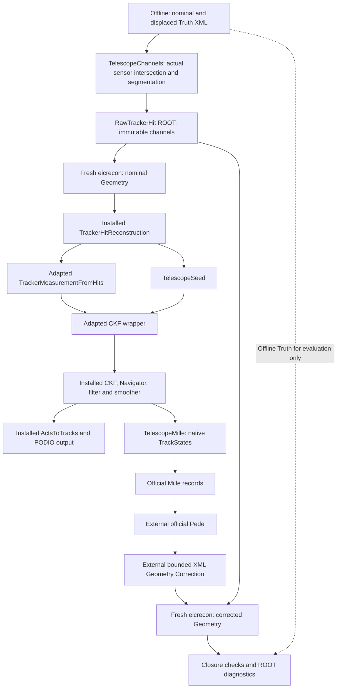

# Telescope alignment: source and processing map

Start with the [user guide](TELESCOPE_ALIGNMENT_USER_GUIDE.md).
This map describes the actual opt-in telescope chain. It is distinct from the
production/reference BeamTestReco path and from standard ePIC reconstruction.
Official source comparisons use pinned EICrecon Git objects at
`195966d41899800eaeca6fbafd63cd53735e6543`, not the external checkout's current HEAD.

## Directory roles

| Directory | Role |
|---|---|
| `localDetEICrecon/experimental/telescope/` | JANA plugins, adapted official modules, telescope producers, provenance and patches |
| `validation/telescope_geometry/` | barrel-compatible telescope XML builder, technical metadata hook, geometry/navigation audit |
| `validation/telescope_one_track/` | independent standalone native CKF reference; not the event-processing path |
| `validation/telescope_factories/` | one-event PODIO fixture, EDM read-back, upstream patch regeneration |
| `validation/telescope_alignment/` | derivative gate, native/legacy comparison, mathematical Mille fixture and label map |
| `validation/telescope_closure/` | offline channels, bounded selected translation/SO(3) XML correction, stage driver and final validation |
| `localDetEICrecon/alignment/` | preserved historical BeamTestMilleWriter, used only for independent equivalence checks here |
| `geometry/`, `reconstruction/`, `alignment/`, `calibration/` | original stages and Python Controller; not replaced or activated |
| `environment/` | fixed Docker bridge and external dependency setup |
| `result/`, `build/` | ignored execution artifacts; historical names remain unchanged |

## Actual processing flow



## Source, principal function and execution boundary

Paths below are relative to the repository root. `T/` means
`localDetEICrecon/experimental/telescope/`, `V/` means `validation/`.

| Source | Principal function / role | Execution |
|---|---|---|
| `V/telescope_geometry/prepare.py` | `prepare`: independent XML fixtures, real modules, metadata declarations | external Python |
| `V/telescope_geometry/BarrelMetadata.cc` | `initializeBarrelMetadata`: Tube layer metadata, sensor axis definitions, actual tracker/barrel flags | DD4hep XML initialization in each geometry process |
| `V/telescope_closure/TelescopeChannels.cc` | `main`: actual VolumeContext transforms, ray/sensor intersection, segmentation and ID checks | separate offline executable |
| `V/telescope_closure/closure.py` | `geometry_step`, `data_step`, `pack`: Truth XML and RawTrackerHit ROOT, separate Truth JSON | external Python |
| `T/TelescopeTracking.cc` | `InitPlugin`: JOmniFactoryGeneratorT collection wiring | eicrecon |
| installed `factories/tracking/TrackerHitReconstruction_factory.h` | official algorithm `process`: channels to TrackerHit, pitch/sqrt(12) errors and RawHit relations | eicrecon |
| `T/algorithms/tracking/TrackerMeasurementFromHits.{h,cc}` | `init`, `process`: SurfaceMap association, local Measurement2D and covariance | eicrecon |
| `T/factories/tracking/TrackerMeasurementFromHits_factory.h` | adapted official factory contract | eicrecon |
| `T/algorithms/TelescopeSeed.h`, `T/factories/TelescopeSeed_factory.h` | `process`: first/last reconstructed hits, outward direction and seed perigee at X=249 mm | eicrecon |
| `T/algorithms/tracking/CKFTracking.{h,cc}`, `CKFTrackingConfig.h`, corresponding factory | `init`, `process`: seed reference and hypothesis adapter to installed CKF | eicrecon |
| installed `ActsToTracks` and factory | native states/tracks to EDM trajectories, parameters, tracks and relations | eicrecon |
| `T/upstream_support/algorithms/meta/CollectionCollector.h` | official unchanged empty subset collector, no Truth association input | eicrecon |
| `T/FactoryAudit.h` | `Process`, `Finish`: actual native and EDM consistency, event diagnostics | eicrecon observer |
| `T/alignment/TelescopeMille.cc` | `Init`: bounded sensor/parameter configuration and identity validation; `Process`, `Finish`: native measurement states to one Mille record per accepted track | eicrecon observer |
| `T/alignment/NativeMilleModel.{h,cc}` | `nativeEquation`: real ACTS propagation and transport/alignment derivatives | called inside observer and external derivative tests |
| `V/telescope_alignment/TelescopeMilleDerivatives.cc` | `main`: analytical/finite-difference gates on actual surfaces | external executable |
| `V/telescope_alignment/l1_l2_global_y.json` | labels 700102/700202 and explicit supported physical Global Y scope | observer configuration |
| `V/telescope_alignment/l1_global_rx.json`, `l1_y_rx_l2_y.json` | selected physical labels, rad unit, current-center pivot, Global left composition and actual L1 IDs | observer configuration |
| `V/telescope_alignment/l1_l2_y_rx_ry_rz_l3_y.json`, `l1_l2_l3_y_rx_ry_rz.json` | explicit selected sensor identities, components, references and containment contract; validated experimental nine-column Scope C and twelve-column Scope D closures | observer configuration |
| `V/telescope_closure/rotation.py` | `rotate_component`, `pose_checks`, `physical_derivatives`, `correct`, `check`: restricted SO(3) serialization and actual-Geometry/native-row validation | external selected-mode helpers |
| `V/telescope_closure/multi_sensor.py` | `configuration`, `labels`, `aligned_sensors`, `references`: explicit physical selection; `pose_increments`, `xml_identity`, `pose_gate`: shared sensor-isolated updates and validation | external Python |
| `V/telescope_closure/multi_information.py` | `analyze`: native calibrated information, four-local-parameter profiling, fixed-reference and nuisance diagnostics | external read-only Python |
| `V/telescope_closure/multi_preflight.py` | `preflight`, `sampled_offsets`, `_bounds`, `_pose_bounds`: prospective covariance-informed corner/envelope checks and actual Geometry reloads | external Geometry-only Python |
| `alignment/pede.py` | `read_pede`: shared text parser, no legacy stage/scope imports | external Python, both workflows |
| `V/telescope_closure/closure.py` | `solve`: official Pede execution and independent Schur comparison | external Python/Pede |
| same | `correct`, `displaced_xml`: Pede text + nominal XML to separate corrected XML, no Truth | external Python |
| same | `reconstruct`: new OS process for each nominal/corrected/control pass | launches eicrecon |
| same | `check`: immutable channels, XML whitelist, data-only GLS, final Truth comparison and ROOT | external Python/PyROOT |
| same | `regressions`: 18 independent commands with separate logs and fresh reference builds | external driver |
| `V/telescope_one_track/TelescopeOneTrack.cc` | `main`: standalone native CKF benchmark | validation only |
| `V/telescope_factories/prepare.py`, `check.py` | minimal PODIO event and native/EDM reference comparison | validation only |
| `V/telescope_alignment/LegacyTelescopeCrosscheck.cc` | `main`: original writer in equivalent coordinates | validation only |
| `V/telescope_alignment/TelescopeMilleFixture.cc` | `main`: separate 16-ray mathematical fixture | validation only |
| `T/factories/SyntheticTrackerHits_factory.h` | benchmark-only synthetic producer; default original one-event path | validation only |

The dependency graph, not factory registration order, controls JANA execution.
Audit and Mille observers request the output collections. Channel closure explicitly
sets `channelInput=true` and both observers' `multipleEvents=true`; the default
one-event benchmark remains independent. Reproducible commands use one thread.

## Official versus local

| Category | Components and reasons |
|---|---|
| Reused unchanged, installed | DD4hep_service, ACTSGeo_service, ActsGeometryProvider, DD4hep converter, TrackingGeometry, SurfaceMap; TrackerHitReconstruction factory/algorithm; actual CKFTrackingFunction with EigenStepper/Navigator/filter/smoother; ActsToTracks; JOmniFactory/JOmniFactoryGeneratorT |
| Unchanged pinned header copies | `extensions/edm4eic/EDM4eicToActs.h` and `upstream_support/algorithms/meta/CollectionCollector.h`; installation lacks these headers. Replace with installed includes when provided and regression-tested |
| Official measurement copy, locally modified | optional B0 constant lookup avoids inventing an absent detector; missing VolumeContext guard; system31/SiMAPSHits CartesianGridXZ covariance projection maps packed sensor X/Z variances into ACTS u/v through J C J^T. Upstream needs equivalent optional detector handling and covariance semantics before direct replacement |
| Official CKF wrapper copy, locally modified | namespace/includes and installed interface adaptation; each seed's perigee is honored instead of assuming origin; electronHypothesis option defaults false, explicitly true for this telescope. Installed numerical CKF is reused. Replace when upstream respects the same seed reference and particle hypothesis |
| Telescope-specific | collection wiring, metadata hook, reconstructed-endpoint seed, native Mille observer, offline channel fixture, configured bounded sensor correction and validation |
| Historical/reference | BeamTestReco, BeamTestACTSFitter, BeamTestMilleWriter, tilt/SO(3) model, original stages/Controller. Preserved unchanged; the new native chain does not substitute these for official tracking |

Official seeding assumes beamline/circle-curvature information and cannot directly
supply this radial, zero-field telescope seed. `TelescopeSeed` is a deliberately
small adaptation, not a new fitter. q/p=-1/GeV is a 1 GeV electron beam prior,
not a measured momentum. Replacing a module requires matching coordinates,
covariance, hypothesis, reference surface and collection contracts, not just types.

Provenance, licenses and reproducible patches live under `T/`. Regenerate patches
using the read-only upstream Git checkout and a new output directory:

```bash
python3 validation/telescope_factories/upstream_diff.py \
  --source /Users/tkumaoka/eic/EICrecon --output result/telescope_upstream_review_fresh
```

The checkout path is an explicit local argument, not a build dependency. Compare
the generated files with `localDetEICrecon/experimental/telescope/upstream_diffs/`.

## Measurement equations and Geometry Correction

The actual native TrackState SourceLink indexes Measurement2D; its hit relation
leads to CellID, converter VolumeID and official SurfaceMap. VolumeID and closed
ACTS GeometryIdentifier are checked for consistency and are not assumed identical.
The earliest accepted smoothed state supplies the common bound reference.
`nativeEquation` repropagates with ACTS, takes transport derivatives for four local
parameters (loc0,loc1,phi,theta), and uses Surface::alignmentToBoundDerivative
including path correction. Local right rotation increments map to Global left
increments through R^T. Enabled scopes are two Global Y translations, separate
L1 Rx/Ry/Rz, L1 Y/Rx plus L2 Y, coupled L1 Ry/Rz, bounded L1 Rx/Ry/Rz, and
bounded L1 Global Y plus Rx/Ry/Rz. The contained four-parameter fixture has six
completed closures; the original wider fixture retains its 5/6 result and one
physical refusal. The new simultaneous L1 four-parameter plus L2 Y scope is
validated experimentally for one prospective cohort, as described below. Other
free translations are not established by that scope. The eight-parameter L1/L2
Y/Rx/Ry/Rz route has passed full closure for four signed fixtures from two
independent seeds. This is validated experimental functionality for the stated
material-free synthetic-channel conditions, not arbitrary six-DOF support.

The equation is measured-minus-prediction = A*localDelta + G*alignmentDelta.
Whitening uses the original calibrated covariance C=L L^T and W=L^-1 for residual
and both Jacobians; official Mille receives scalar sigma=1. Smoothed covariance
is not substituted for measurement errors, and no seed-prior equations are added.
Pede profiles four local parameters per track and solves the shared global
labels in the selected explicitly whitelisted scope.
Nonzero field, assigned material and observable q/p/time contributions are guarded
as unsupported. Derivative validation alone does not establish general six-DOF closure.

`correct` reuses `alignment.pede.read_pede`; `displaced_xml` reuses
`geometry.transforms.matvec/transpose` to map physical Global Y into module axes.
Only selected module references, sensitive-component translations and the selected
sensitive-component orientation serialization change; all
other XML attributes/text are whitelisted. Same channel bytes are decoded again
in a fresh process. No Controller registry or Geometry activation is involved.
The historical writer remains an independent straight-line equivalence reference.

ACTS stored NDF counts measured dimensions (10 per track). Pede statistical NDF
is N*(10-4)-G for N accepted tracks and G free global parameters; the original
32-track/two-Y reference has 32*(10-4)-2=190. Native CKF includes the seed prior;
profiled Pede does not.
Their chi2 values and denominators therefore have distinct meanings. No covariance
rescaling or uncertainty-coverage claim follows from the successful closure.

## Historical terminology

Historical `BARREL_*` report filenames and `result/barrel_*` directories record
past executions and remain intact. Their old source commands refer to that revision;
this guide and code map provide current paths. Technical names retained include
`BarrelMetadata.cc`, `TestbenchBarrelMetadata`, `initializeBarrelMetadata`,
`DD4hep_SiTrackerBarrel`, XML `barrel_envelope`, ACTS CylinderLayer and unchanged
official ePIC barrel detector constants. The existing manifest key `barrel_field`
is retained for output-schema compatibility. None implies that the physical
beam-test telescope is the ePIC barrel detector.

## Consolidation boundary

The [implementation audit](TELESCOPE_IMPLEMENTATION_AUDIT.md) inventories retained
modules, dependencies and deleted duplicate build entries. This synthetic-channel
closure is the active EICrecon-based development workflow. The old endcap backend
remains a capability/reference implementation: its validated rotations, SO(3),
Geant4/digitization and sequential Controller lifecycle are not yet replaced by
these selected material-free native fixtures. Do not infer that those features are
available in this native chain. No automatic Geometry activation is provided.

The Pede text parser now lives in `alignment/pede.py`; it has no dependency on the
legacy solver CLI or correction scopes. `alignment.align.read_pede` remains an
import-compatible alias for external callers. Pede itself is still the official
external executable, not Python numerical inference.

## Native rotation milestone

The [parity report](TELESCOPE_ALIGNMENT_LEGACY_PARITY.md) distinguishes the legacy
fixed-ordered Rx/Ry failure, later SO(3) controlled results, incomplete three-layer
claims and the native tests. `TelescopeMilleProcessor::Init` accepts only the
explicit label sets; `Process` selects column 1 (Y) or columns 3/4/5 (Rx/Ry/Rz) from
the **unchanged** `NativeMilleModel` after its original whitening. Config parameters
and decoded Mille labels are authoritative for a multi-parameter sensor; the old
scalar equation `label` field remains for the original Y-only comparison.

`TelescopeChannels::main` now also reports actual DD4hep basis columns.
`closure.py::displaced_xml` permits selected L1/L2 sensitive-component rotations
for bounded geometry validation and preserves untouched
XML attributes in rotation fixtures. `geometry_step` generates test Truth;
`rotation.correct` reads Pede and nominal XML only. The same native reconstruction
is then restarted with corrected Geometry. `rotation.physical_derivatives` is an
independent finite-difference validator of actual sensor poses and frozen native
references; it is never an inference model. Existing generic mathematical gates,
standalone CKF and legacy-equivalence tests remain independent.

Single-axis routes retain their restricted charts; coupled routes compute a
full SO(3) target matrix before XML serialization. Arbitrary Survey Geometry,
fitted Global X/Z combined with tilts, multi-layer six-DOF, sequential Controller
operation and original Geant4/RawHit compatibility remain unrestored. The retained legacy implementation is unchanged.

## Bounded three-rotation extension

`rotation.py` routes `l1_rx_ry_rz` and its negative fixture through the same
native channel/CKF/Mille chain. `TelescopeMille::Init` admits exactly labels
700104/700105/700106 for this scope; `NativeMilleModel` still supplies physical
Global rotation columns 3/4/5 without modification. Translations and other
sensor poses remain fixed. The XML serializer computes the full left-Global
target matrix before extracting the verified DD4hep component chart. It is
restricted to this telescope mounting and bounded poses, not arbitrary Survey
Geometry. See the [three-axis validation](TELESCOPE_ALIGNMENT_LEGACY_PARITY.md#three-axis-native-so3-milestone)
for prospective gates, actual results, regressions and remaining legacy gaps.

## Explicit L1 Y plus SO(3) validation

This remains experimental: the six-case checkpoint is 5/6 complete closures, with
one physically invalid fitted module candidate correctly refused. No native
full-six-DOF or unconditional four-parameter support is claimed.

The exact four-label configuration `l1_global_y_rx_ry_rz.json` enables Global Y
(column 1, mm) alongside the existing rotation columns 3/4/5 (rad). Other physical
parameters remain fixed. `rotation_labels` separates the angular coordinates
from translation; `fixture_shifts` supplies the world displacement. The existing
native matrix, transport, whitening, fitter and selector are unchanged.

`rotation.refine` implements an explicitly requested second Geometry correction
for bounded selected Y/SO(3) scopes. It reads the completed first post-correction Pede result,
updates the current center and left-multiplies its current orientation, and
reloads the XML for actual surface checks. Exclusive immutable stages limit this
to one additional correction. `closure.main --refine-once` connects its separate
reconstruction/derivative/Pede stages. It does not extend the Controller or
activate Geometry. `rotation.check` retains the initial covariance, scores the
final pose and updates using unchanged gates, and records the initial one-step
outcome independently. See the parity report for the scope amendment and limits.

## Unchanged-envelope fixture and permanent physical refusal

`rotation.is_four` recognizes two additional **fixture aliases**,
`l1_y_rx_ry_rz_contained` and its negative form. They select the same four labels
and native equations; only their physical injection is different. Original mode
amplitudes and numerical baselines remain unchanged. New fixtures compare
like-signed Euler products with their joint Exp(w); historical diagnostic values
are retained. This changes no fit or SO(3) update primitive.

`validation/telescope_closure/containment.py` is a validation utility, not an
alignment constraint or tracking component. `corners_in_module` independently
transforms all eight silicon corners into the parent frame. `preflight` uses
prior joint information for a geometry-only design and actual constructor
reloads. `expected_refusal` re-solves the preserved original Mille Binary,
verifies the original fit byte-for-byte, reloads its candidate, and requires
`pose_checks` to refuse it before any corrected tracking. It also verifies that
the original failed fit remains in the initial statistical summary.
The permanent classification is `EXPECTED_PHYSICAL_CONTAINMENT_REFUSAL`, with
`physical_closure_passed=false`. Three new beam recipes provide independent
seeds without changing the existing angular distribution. Four unit tests cover
parent-frame invariance, first-order extent, joint-error sampling, and original
fixture/label preservation. No runtime provider, navigator, fitter or solver is
added; the numerical C++ tree is unchanged from the starting uncommitted feature.

## Bounded L1/L2 selection: five-parameter development scope

Scope A selects L1 Global Y/Rx/Ry/Rz and L2 Global Y together. Its explicit mode
is `l1_y_rx_ry_rz_l2_y`, with `_negative` selecting the opposite L1 rotation
vector while retaining both translations. This section describes the implemented
route; full closure passed for one prospective 4096-track cohort and
is recorded separately in the parity report. It does not declare eight-parameter
or arbitrary six-DOF alignment support.

| Maintained module | Responsibility |
|---|---|
| `localDetEICrecon/experimental/telescope/alignment/TelescopeMille.cc` | Validate the selected configuration, identify each actual native measurement sensor, and write only that sensor's selected global columns to official Mille Binary. |
| `validation/telescope_alignment/l1_y_rx_ry_rz_l2_y.json` | Declare five physical labels, units, pivots, composition and distinct actual sensor identities. |
| `validation/telescope_closure/multi_sensor.py` | Decode the bounded label selection, define signed fixtures, separate per-sensor increments, check XML changes and validate physical composition/inverse operations. |
| `validation/telescope_closure/multi_information.py` | Profile four local parameters from actual native equations; report accumulated information, covariance, cross-sensor correlations, sample-size/beam subsets, omitted-X/Z diagnostics and reference-release gauge directions. |
| `validation/telescope_closure/multi_preflight.py` | Read unchanged module/layer bounds and earlier native information; sample a joint-error design before new recovery, then reload actual DD4hep/ACTS poses. |
| `validation/telescope_closure/closure.py` | Keep the existing independent geometry, data, reconstruction and official Pede stages; dispatch the selected scope and enforce observability before Pede. |
| `validation/telescope_closure/rotation.py` | Reuse matrix-first correction, actual pose/containment checks, finite-difference validation, optional single additional correction, native coefficient auditing and ROOT closure output. |
| `validation/test_native_multi_sensor.py` | Test label/sensor separation, shared-module isolation, independent translations, noncommuting composition, fixed-sensor protection and refusal of unrelated XML changes. |

The actual association remains:

```
native TrackState SourceLink
  -> Measurement2D index -> associated hit CellID
  -> DD4hep converter Volume context -> official SurfaceMap
  -> the identical native reference Surface and GeometryIdentifier
  -> selected configuration entries for that physical sensor
  -> original native global derivative columns -> original whitening -> Mille
```

The L1 VolumeID/ACTS GeometryIdentifier pair is
`272631839 / 216173056991691039`; the independently discovered L2 pair is
`272633887 / 216173194430644511`. These are different identifier spaces and
different sensors. Labels 700102/700104/700105/700106 map to L1 columns 1/3/4/5;
700202 maps to L2 column 1. Columns are zero-based Global X/Y/Z/Rx/Ry/Rz.
Fixed L0/L3/L4 measurements retain local track information and have no selected
free global coefficients. Native SourceLinks, CellIDs, SurfaceMap associations
and configured identities are checked at runtime rather than inferred from the
label value alone.

The installed EICrecon geometry service/`ActsGeometryProvider`, DD4hep conversion,
official SurfaceMap, native measurement conversion and installed ACTS CKF path
are unchanged. `NativeMilleModel` equations, calibrated covariance/whitening,
four-local-parameter model, electron hypothesis, CKF selection and official
Millepede-II steering are also unchanged. No provider, navigator, fitter or
solver is added by these Python validation helpers.

Both sensors' corrections come from one simultaneous Pede result. Each selected
sensitive component is isolated by cloning its placed shared module definition;
unrelated module templates, placements and material/segmentation/envelope nodes
remain exact. For each sensor the update is
`c_new=c_current+(0,dY,0)` and `R_new=Exp(dw_global) R_current`, about its current
physical sensitive center. L2 has no rotation increment in Scope A. The current
orientation is serialized from the target matrix, then freshly loaded DD4hep
and ACTS matrices, IDs and all eight sensitive corners are checked before
corrected reconstruction can start. An invalid candidate is preserved and
refused rather than clipped or accommodated by enlarging its mother.

Gauge handling is explicit fixed-reference selection, not a hidden prior:
L0/L3/L4 poses and L1/L2 X/Z stay fixed. Actual local rank must be four per track;
individual tracks need not resolve every global parameter. The accumulated
selected design must have rank five and satisfy the existing scaled-condition
and sensitivity gates before Pede. Releasing all reference poses is a separate
diagnostic that exposes common rigid gauge directions; those extra columns are
never fitted or used to regularize the selected model. Prospective ellipsoid
sampling is engineering evidence, not uncertainty coverage. The optional
`--refine-once` stage retains the existing 20 nm translation and quarter-initial-
sigma angular post-update gates and permits at most one additional correction.
No Controller iteration, Geometry activation or full six-DOF mode is introduced.

The Scope A audit uses the following manual inputs. Existing output directories
are immutable: use a new suffix for each output path when reproducing these
commands. The fixed Docker container name is an explicit local environment
choice.

```bash
TESTBENCH_CONTAINER=sweet_mahavira bash environment/run.sh \
  cmake -S /work/localDetEICrecon/experimental/telescope \
  -B /work/build/native_multi_20261024_01 \
  -DCMAKE_BUILD_TYPE=Release -DTELESCOPE_BUILD_MILLE_PROBE=ON
TESTBENCH_CONTAINER=sweet_mahavira bash environment/run.sh \
  cmake --build /work/build/native_multi_20261024_01 -j2

TESTBENCH_CONTAINER=sweet_mahavira bash environment/run.sh \
  python3 -B validation/telescope_closure/multi_preflight.py \
  --build build/native_multi_20261024_01 \
  --prior-run result/native_containment_seed1_positive_20261024_01 \
  --output-dir result/native_multi_20261024_01_audit/geometry_preflight \
  --mode l1_y_rx_ry_rz_l2_y

TESTBENCH_CONTAINER=sweet_mahavira bash environment/run.sh \
  python3 -B validation/telescope_closure/closure.py \
  --build build/native_multi_20261024_01 \
  --result result/native_multi_scope_a_seed1_positive_20261024_01 \
  --mode l1_y_rx_ry_rz_l2_y --events 4096 \
  --beam validation/telescope_alignment/multi_beam_seed1.json \
  --chi2-cut 1000 --refine-once --step all
```

The same invocation accepts each independent `--step` in place of `all`:
`geometry`, `data`, `nominal`, `solve`, `correct`, `corrected`, `postsolve`,
`refine`, `refined`, `refinesolve`, `control`, `controlsolve`, `check`.
Each requires complete, unmodified preceding artifacts and creates fresh stage
outputs. `solve` also performs the real-geometry derivative/pose gates. The
read-only `multi_information.py --native RUN/nominal/mille.json --output NEW.json`
command exposes the selected and diagnostic designs independently. The final
`validation/report.json` and `validation/rotation.root` retain closure metrics
and ROOT histograms; they distinguish initial nominal covariance from final
cumulative geometry without combining correlated successive-fit errors.

## Eight-parameter L1/L2 development scope

Scope B uses `l1_l2_y_rx_ry_rz` and its `_negative` fixture. Its implementation
reuses the Scope A helpers and native path; all four selected signed fixtures
passed full reconstruction closure. The additional explicit configuration is
`validation/telescope_alignment/l1_l2_y_rx_ry_rz.json`. No new geometry provider,
navigation, fitter, derivative model or solver is introduced.

| Physical sensor | Global Y [mm] | Global Rx [rad] | Global Ry [rad] | Global Rz [rad] |
|---|---:|---:|---:|---:|
| L1, VolumeID 272631839 / ACTS ID 216173056991691039 | 700102 | 700104 | 700105 | 700106 |
| L2, VolumeID 272633887 / ACTS ID 216173194430644511 | 700202 | 700204 | 700205 | 700206 |

`multi_sensor.labels`, `mapping` and `pose_increments` keep each sensor's three
rotation components together and reject incomplete or nonfinite updates. The
runtime observer still verifies the actual SourceLink/CellID/VolumeID/SurfaceMap
association before selecting columns 1/3/4/5 for that sensor. Fixed reference
layers L0/L3/L4 retain no free global labels, and both sensors' X/Z stay fixed.
The Scope A label list and physical fixture remain unchanged.

One eight-parameter Pede solution updates both sensitive components in separate
placed module clones. Each update uses its own current center and current
orientation: world Y translation followed by the independent active left-Global
`Exp(dw)` multiplication. The shared original template and unrelated XML remain
exact; matrix serialization, actual DD4hep/ACTS reloads and all eight daughter
corners in both unchanged mothers/layers are checked. The actual-geometry
finite-difference gate selects all eight sensor/column pairs at three step sizes
per parameter, using each event's frozen native reference and the corresponding
sensor's original ACTS derivative. Cross-sensor coefficient auditing separately
checks every scalar official Mille record.

The fitted information matrix is eight by eight after profiling four local
track parameters independently per event. Its full covariance, axis and
cross-sensor correlations, prefix sample sizes and slope/impact subsets come
from the original calibrated measurement covariance. A separate twelve-column
L1/L2 diagnostic adds omitted pose components including X/Z; a thirty-column
diagnostic releases all five SiMAPS reference poses and tests rigid gauge
directions. Those diagnostic columns do not enter Pede or supply priors.
Accumulated rank eight, the existing scaled-condition/sensitivity limits and
fixed-reference/gauge consistency are required before the eight-label Pede fit.

The independent information calculation and Pede both profile data-only local
track corrections; no CKF seed-prior equations are added to Mille. Initial
nominal Pede errors must agree with the unscaled inverse information from the
same initial native equations. Later relinearized errors describe their current
linearization and remain separate from the initial errors; same-channel fit
uncertainties are never combined as independent measurements. Geometry closure
and stable post-updates alone do not establish uncertainty coverage or absence
of statistical bias. Pede's statistical NDF is `6*N-8`; ACTS stored NDF remains
ten measured dimensions per track.

The prospective fixture keeps L1 (Y,Rx,Ry,Rz) at
(+0.080 mm,+1.0,+0.5,-0.5 mrad), and sets L2 to
(-0.060 mm,-1.2,+0.6,+0.6 mrad). The negative fixture reverses both rotation
vectors while retaining the translations. Both signed fixtures are checked
before new Pede recovery, using the recorded earlier information and unchanged
physical bounds. These are bounded geometry-validation fixtures, not a claim
of arbitrary detector-motion support.

The primary Scope B run uses seed 2026102701 with the same bounded broad-angle
recipe. The current reconstruction build, including the observer-only precision
correction described below, is `build/native_multi_precision_20261024_01`;
the primary retry is `result/native_multi_scope_b_seed1_positive_20261024_02`.
The following is a **fresh reproduction recipe**, not the command history of
that retry. It uses the unused example output
`result/native_multi_scope_b_reproduce_01` and the recorded final build path;
choose a fresh build suffix when rebuilding rather than replacing that build.
The preflight output is also a new example. The actual prospective preflight
was executed earlier with `build/native_multi_20261024_01`, using the unchanged
`TelescopeChannels` geometry probe. All independent stage names remain available
through `closure.py --step`.

```bash
TESTBENCH_CONTAINER=sweet_mahavira bash environment/run.sh \
  cmake -S /work/localDetEICrecon/experimental/telescope \
  -B /work/build/native_multi_precision_20261024_01 \
  -DCMAKE_BUILD_TYPE=Release -DTELESCOPE_BUILD_MILLE_PROBE=ON
TESTBENCH_CONTAINER=sweet_mahavira bash environment/run.sh \
  cmake --build /work/build/native_multi_precision_20261024_01 -j2

TESTBENCH_CONTAINER=sweet_mahavira bash environment/run.sh \
  python3 -B validation/telescope_closure/multi_preflight.py \
  --build build/native_multi_precision_20261024_01 \
  --prior-run result/native_containment_seed1_positive_20261024_01 \
  --output-dir result/native_multi_scope_b_preflight_reproduce_01 \
  --mode l1_l2_y_rx_ry_rz

TESTBENCH_CONTAINER=sweet_mahavira bash environment/run.sh \
  python3 -B validation/telescope_closure/closure.py \
  --build build/native_multi_precision_20261024_01 \
  --result result/native_multi_scope_b_reproduce_01 \
  --mode l1_l2_y_rx_ry_rz --events 4096 \
  --beam validation/telescope_alignment/multi_beam_seed1.json \
  --chi2-cut 1000 --refine-once --step all
```

The actual primary retry did **not** execute `--step all`. It copied the
hash-verified immutable inputs and completed geometry, nominal/first-corrected,
derivative, solver and refinement checkpoints from the original `_01` attempt
to `_02`; their original command records were retained. It then executed only
the following five stages with the corrected observer. The source attempt and
its partial failure remain intact. This is the same seed/sample, not new
simulation or another independent statistical observation. The copy hashes and
stage inventory are recorded in
`result/native_multi_20261024_01_audit/primary_retry_provenance.json`.
The loop below records the executed invocations; the completed `_02` stages
must not be rerun in place.

```bash
for step in refined refinesolve control controlsolve check; do
  TESTBENCH_CONTAINER=sweet_mahavira bash environment/run.sh \
    python3 -B validation/telescope_closure/closure.py \
    --build build/native_multi_precision_20261024_01 \
    --result result/native_multi_scope_b_seed1_positive_20261024_02 \
    --mode l1_l2_y_rx_ry_rz --events 4096 \
    --beam validation/telescope_alignment/multi_beam_seed1.json \
    --chi2-cut 1000 --refine-once --step "$step"
done
```

The prospective plan and all validation artifacts reside under
`result/native_multi_20261024_01_audit/` and the separate Scope B run directory.
No candidate is activated, the Controller is unchanged, and no additional
sensor, X/Z fit or full six-DOF scope is enabled by this development.

The final Scope B checkpoint contains four passing signed fixtures, each with
4096 accepted tracks, from seeds 2026102701/2026102702. The two signs share their
seed's rays; there are two independent cohorts, not four. Initial selected rank
is eight and scaled conditions span 3.1652–3.2946. ACTS chi2/stored-NDF improves
from 10.1045–10.1756 to 0.5931–0.6048. All 16 Pede stages terminate normally with
zero rejected local fits and no error rescaling. All proposed updates retain
the unchanged physical containment and original post-update gates. The twelve
real-geometry derivative gates total 1179648 two-coordinate vector checks;
maximum errors are 3.310e-8 mm/rad and 5.460e-10 mm/mm. Results, initial mixed-unit
covariances, cross-sensor correlations and cumulative geometry are retained in
`result/native_multi_20261024_01_audit/scope_b_four_fixture_summary/summary.json`.
These are geometry/derivative/observability/closure results, not statistical
coverage or a material-aware performance validation.

## Observer precision contract and independent geometry check

`FactoryAudit::Process` is an observer; it does not fit tracks or mutate event
data. An initial Scope B refined-reconstruction attempt was stopped by its
fixed `1e-6 mm` local-coordinate difference-norm assertion. The retained event
355 L2 measurement has legitimate double-to-binary32 rounding with norm
`1.019234011353496e-6 mm`, although each coordinate is within half its float ULP.
Actual partial ROOT output confirms the stored coordinates. The original
failure and its diagnostic artifacts remain under the original `_01` run and
`result/native_multi_20261024_01_audit/measurement_precision_diagnosis/`.

The corrected observer checks the official converter's exact contract:
`static_cast<float>(local[0]) == measurement.getLoc().a` and the corresponding
`local[1]`/`.b` identity, together with finite coordinates and the unchanged
Surface identity check. The converter already
performs this explicit cast when creating `Measurement2D`. This detects a
one-ULP corrupt value even where its absolute difference is below the old
threshold; it does not add an adjustable tolerance. Installed ACTS PlaneSurface
conversion ignores the momentum direction, so the observer and converter use
the same coordinate transform.

A separate strict geometry check now starts from the unrounded DD4hep CellID
channel-center position: convert it to ACTS local coordinates and back to
global coordinates, requiring the full round-trip error below `1e-6 mm`.
This tests the physical DD4hep/ACTS plane correspondence before EDM rounding.
It does not require a float-serialized global hit position to have double
precision. Covariance checks, all-eight-corner containment, fitted states,
measurement conversion, tracking algorithms, Mille equations and physics
settings are unchanged. The actual ROOT/EDM unit test retains the failed
coordinate pair and demonstrates that legitimate rounding and one-ULP
corruption remain distinguishable.

The fresh precision build passed the complete 18-command regression suite at
`result/native_multi_regression_l1_l2_y_20261024_01/precision_complete_regressions/`:
all 18 recorded exit codes are zero and the immutable completion marker is
present. This includes fresh standalone geometry/CKF builds, geometry and EDM
comparisons, native/legacy mathematical equivalence, official Pede, all 91 unit
tests (17 multi-sensor tests), and safety/preservation checks. Existing SQLite
ResourceWarnings remain visible in the test log. Preservation verifies 221
baseline records, 2046 relocated files, maintained input links and pinned
validated sources. Safety checks retain their refusal cases for overwrites,
incomplete/modified stages, escaped paths, invalid scenarios and ungated legacy
alignment entry points. These software checks do not by themselves declare
full Scope B reconstruction closure or statistical validity.

The following checks can also be run independently in the fixed container.
The consolidated command uses the completed original two-Y baseline and creates
a fresh validation stage and fresh standalone build directories; change
`--validation-name` before repeating it.

```bash
TESTBENCH_CONTAINER=sweet_mahavira bash environment/run.sh \
  python3 -B -m unittest discover -s validation -p 'test_*.py'
TESTBENCH_CONTAINER=sweet_mahavira bash environment/run.sh \
  python3 -B -m unittest validation.test_native_multi_sensor -v
TESTBENCH_CONTAINER=sweet_mahavira bash environment/run.sh \
  python3 -B validation/check_safety.py
TESTBENCH_CONTAINER=sweet_mahavira bash environment/run.sh \
  python3 -B validation/verify_preservation.py
TESTBENCH_CONTAINER=sweet_mahavira bash environment/run.sh \
  python3 -B validation/telescope_closure/closure.py \
  --build build/native_multi_precision_20261024_01 \
  --result result/native_multi_regression_l1_l2_y_20261024_01 \
  --mode l1_l2_y --events 32 --chi2-cut 1000 \
  --step regressions --validation-name precision_complete
```

Every consolidated subcommand has its exact arguments, working directory,
stdout/stderr and exit code in its own `command.json`, `stdout.log` and
`exit.json`. The audit-only correction is isolated in `FactoryAudit.h`; it
does not change an installed EICrecon/ACTS component or replace the retained
failed reconstruction outputs.

The twelve historical modes and six contained L1 four-parameter fixtures also
passed complete closure using the Scope A build, with protected XML/Mille bytes
and scientific reports unchanged except regenerated ROOT container metadata.
The final precision-build plugins were then executed over every event of those
18 final-geometry datasets plus Scope A: 19 separate replay jobs and 49280
events. Every full Mille Binary is byte-identical, and all ACTS fitted states
and audit values match. Only the explicitly verified fresh `derivative_gate`
output-path metadata is excluded when comparing the native equation JSON; no
numerical field is excluded. This final-build replay complements the earlier
full closure reruns; it is not described as nineteen new complete closures.
Evidence is recorded in
`result/native_multi_20261024_01_audit/baseline_identity.json` and
`result/native_multi_20261024_01_audit/final_plugin_full_replay_summary.json`.

## Configured L1/L2/L3 selection: Scope C checkpoint

The three-sensor extension changes selection and validation adapters. It reuses
the same native measurement equations, four local track parameters, installed
ACTS tracking, calibrated covariance, whitening and official Mille/Pede path.
`FactoryAudit.h`, including its validated binary32 serialization contract, and
`NativeMilleModel.{h,cc}` are byte-identical to Scope B commit
`4f31408f7736bf28eceb62c187fd9142714ea72e`.

| Configuration in `validation/telescope_alignment/` | Selected physical components | References | Status at the Scope C checkpoint |
|---|---|---|---|
| `l1_l2_y_rx_ry_rz_l3_y.json` | L1/L2 Y/Rx/Ry/Rz and L3 Y: nine columns | L0/L4 fixed | One complete 4096-track native closure passed; official nominal/refined nine-label binaries checked |
| `l1_l2_l3_y_rx_ry_rz.json` | L1/L2/L3 Y/Rx/Ry/Rz: twelve columns | L0/L4 fixed | Prospective preset; not a validated twelve-parameter closure at this checkpoint |

All Global X/Z translations remain fixed. These configurations do not enable a
general six-DOF fitter. The original Scope A/B names and configurations remain
available. The `_negative` fixture names reverse the selected rotation vectors
and retain the translations; each signed pair shares its seed's trajectories.
Physical injection values belong to `multi_sensor.fixture` and the separate
validation records. They are absent from the configuration passed to Mille.

Actual identities were obtained from accepted native measurement associations
and independently reloaded DD4hep/ACTS Geometry, not calculated from label
numbers:

| Sensor | DD4hep VolumeID | ACTS GeometryIdentifier | Physical labels |
|---|---:|---:|---|
| L1 | 272631839 | 216173056991691039 | Y 700102; Rx/Ry/Rz 700104/700105/700106 |
| L2 | 272633887 | 216173194430644511 | Y 700202; Rx/Ry/Rz 700204/700205/700206 |
| L3 | 272635935 | 216173331869597983 | Y 700302; Rx/Ry/Rz 700304/700305/700306 |

The new JSON metadata makes the bounded contract explicit:

| Key | Meaning and checked values |
|---|---|
| `aligned_sensors` | Actual system/layer/VolumeID/GeometryIdentifier and enabled `components` for each selected sensor |
| `parameters` | Ordered physical axes, integer Mille labels, units, pivot, composition and matching actual sensor IDs |
| `fixed_reference_sensors` | `[0,4]`; selected and reference sensors partition SiMAPS L0–L4 |
| `fixed_components` | `global_x`, `global_z` |
| `correction_pivot` | `sensitive_surface_center` |
| `translation_convention` | `world_translation` |
| `rotation_composition` | `left_global_exp` |
| `containment` | Unchanged module and layer envelopes; all eight sensitive corners checked by the external Geometry gates |

`TelescopeMilleProcessor::Init` replaces the former whole-mode label whitelist
with bounded component validation. It accepts only Global Y and Global
Rx/Ry/Rz on selected SiMAPS L1–L3, checks unique integer labels and identities,
checks the declared component sets against parameter rows, and rejects
selected/reference overlap. Existing JSONs without the new metadata retain
their previous L1/L2 schema. The actual measurement association in `Process`
is unchanged:

```text
native TrackState SourceLink -> Measurement2D -> linked TrackerHit CellID
    -> actual DD4hep VolumeContext -> official SurfaceMap
    -> native/EDM/SourceLink surface identity checks
    -> selected parameter rows for that measured sensor
    -> existing ACTS derivative columns and calibrated whitening
    -> official MilleRecord
```

The fixed reference sensors still contribute local track measurements, with no
free global labels. Independent audits checked every nominal and refined
event: 4096 records, 40960 scalar measurements, the exact nine-label set and
8192 occurrences per label in each official decoded binary. Runtime L3 IDs
match the configuration. The records and associations are retained in
`result/native_three_sensor_20261024_01_audit/scope_c_native_association/`,
`scope_c_refined_association/`, and `official_binary_scope_c_{nominal,refined}/`.

The Python control flow remains small:

1. `multi_sensor.configuration` reads the selected JSON. `labels`,
   `aligned_sensors` and `references` derive the ordered parameter list,
   selected layers and fixed complement. The mode-to-file table preserves
   existing CLI names.
2. `closure.geometry_step` and correction helpers call the existing
   `displaced_xml` with explicit `allowed_layers`. Its default remains L1/L2,
   preserving the former refusal of an undeclared L3 update.
3. `rotation.correct` and `refine` parse one Pede result and use
   `multi_sensor.pose_increments` to update all selected sensors together.
   Each receives `c_new=c_current+(0,dY,0)` and
   `R_new=Exp(dw_global) R_current`, about its current sensitive center.
   The shared sensitive component is cloned per changed layer; no separate
   L3 correction algorithm is introduced.
4. `xml_identity` whitelists selected component positions/orientations and
   layer module references. An unchanged selected reference is skipped during
   normalization, permitting isolation tests; the final whole-XML comparison
   still rejects changes to a shared definition, fixed sensor or unrelated
   attribute. `pose_checks` verifies actual matrices, centers, identities,
   eight-corner containment and the unchanged layer mothers for L1–L3.
5. `multi_information.analyze` profiles four local parameters independently
   per track, then accumulates the selected information. References derive
   from the selected layers. For Scope C it checks rank nine and separately
   diagnoses all eighteen pose columns on L1/L2/L3. The latter is an omitted-
   component diagnostic, not an additional fit or constraint. Cross-sensor
   correlations are reported for L1/L2, L1/L3 and L2/L3. Per-track global rank
   need not equal nine or twelve.

The prospective Scope C fixture adds L3 Y=+0.050 mm to the unchanged Scope B
injections. Its seed is 2026102801, with 4096 trajectories from the unchanged
bounded broad-angle recipe. Geometry-only preflight used the earlier Scope B
native information: 360 sampled joint poses across both signs and 38 real
DD4hep/ACTS reloads. Above eight parameters, `sampled_offsets` samples each
sensor's marginal covariance and lifts the displacement through
`C_:S C_SS^-1`; this retains the full covariance correlations without an
exponential global grid. The five-nominal-sigma radius and 10% engineering
margin are fixture-design choices, not calibrated statistical coverage or an
exhaustive containment proof. Module and layer dimensions are read from the
unchanged XML, and actual worst sampled poses are reloaded independently.

The actual initial Scope C selected rank is nine, with diagonal-scaled
condition 3.684623. The read-only eighteen-column diagnostic has full rank;
its largest selected angular nominal error is 0.491219 mrad, below the
predeclared 0.5 mrad sensitivity gate. Every correction must also satisfy the
unchanged physical and post-fit gates. These facts establish Geometry,
derivative and observability evidence; they do not establish uncertainty
coverage or material-aware electron performance.

The completed Scope C report is
`result/native_three_sensor_scope_c_seed1_positive_20261024_01/validation/report.json`.
All 4096 tracks remain accepted. ACTS chi2/stored-NDF improves from
12.23708787187934 to 0.6045734615695437. One explicitly requested additional
correction was applied; the first one-step post-fit gate already passed and
remains recorded separately. Final Y updates are below 0.038 nm in magnitude,
and the largest angular update is 0.192 microrad, within the unchanged gates.
This single cohort validates the implemented closure; it is not an uncertainty
coverage study.

The following records the **executed** Geometry preflight and reconstruction
invocations. Their outputs already exist and must not be rerun in place.
The preflight used the unchanged prior geometry probe; the reconstruction
used the new Scope C build.

```bash
TESTBENCH_CONTAINER=sweet_mahavira bash environment/run.sh \
  cmake -S /work/localDetEICrecon/experimental/telescope \
  -B /work/build/native_three_sensor_c_20261024_01 \
  -DCMAKE_BUILD_TYPE=Release -DTELESCOPE_BUILD_MILLE_PROBE=ON
TESTBENCH_CONTAINER=sweet_mahavira bash environment/run.sh \
  cmake --build /work/build/native_three_sensor_c_20261024_01 -j2

TESTBENCH_CONTAINER=sweet_mahavira bash environment/run.sh \
  python3 -B validation/telescope_closure/multi_preflight.py \
  --build build/native_multi_precision_20261024_01 \
  --prior-run result/native_multi_scope_b_seed1_positive_20261024_02 \
  --output-dir result/native_three_sensor_20261024_01_audit/geometry_preflight_c \
  --mode l1_l2_y_rx_ry_rz_l3_y

TESTBENCH_CONTAINER=sweet_mahavira bash environment/run.sh \
  python3 -B validation/telescope_closure/closure.py \
  --build build/native_three_sensor_c_20261024_01 \
  --result result/native_three_sensor_scope_c_seed1_positive_20261024_01 \
  --mode l1_l2_y_rx_ry_rz_l3_y --events 4096 \
  --beam validation/telescope_alignment/three_sensor_beam_seed1.json \
  --chi2-cut 1000 --refine-once --step all
```

Build configure/build logs are recorded in the audit directory. For a fresh
reproduction, choose an unused build suffix and an unused result directory;
configure `localDetEICrecon/experimental/telescope` with
`-DCMAKE_BUILD_TYPE=Release -DTELESCOPE_BUILD_MILLE_PROBE=ON`, build it, and use
that path in the stage commands. Input channels, per-stage command/exit logs,
Pede results, candidate XML, actual geometry audits and ROOT diagnostics are
kept in the separate run directory. `--step` still permits independent manual
execution of every existing stage. No automatic Controller or activation is
added.

At the Scope C checkpoint, the 11 new targeted tests and 17 retained
multi-sensor tests passed. The final 102-test and complete eighteen-command
regression runs are separate end-of-milestone requirements; this checkpoint
does not report them as executed. Full closure, regression and prospective
Scope D status are maintained in the parity report.

## Scope D: validated experimental twelve-parameter closure

The primary `l1_l2_l3_y_rx_ry_rz` cohort has now completed all seventeen native
closure stages. It uses the same frozen
`build/native_three_sensor_c_20261024_01` plugin and the same source committed
for Scope C (`c0852aecbec65c75b32e907bf51b5bf4c5b5d417`). Enabling L3 rotations
changes the selected JSON and prospective fixture, not the provider, navigator,
fitter, numerical derivatives, measurement covariance or correction algorithm.
The table above records the earlier Scope C checkpoint, when this preset was
still prospective.

`l1_l2_l3_y_rx_ry_rz.json` declares Y/Rx/Ry/Rz for each of L1/L2/L3, actual
sensor IDs, fixed L0/L4 references, fixed X/Z translations and the existing
center-pivot/left-Global/unchanged-envelope contract. `Init` consumes this
declaration directly. The unchanged `Process` branch matches each actual
measured sensor before selecting its four derivative columns. In particular,
L3 uses VolumeID 272635935, ACTS GeometryIdentifier 216173331869597983 and labels
700302/700304/700305/700306. Its fitted rotations do not use L1/L2 identities or
modify their shared sensitive-component definitions in place.

The primary source and output directory is
`result/native_three_sensor_scope_d_seed1_positive_20261024_01/`.
It uses seed 2026102801, 4096 trajectories, the unchanged bounded beam and
measurement settings, and the three translations from Scope C. L3's added
physical rotation vector is (+0.8,-0.4,+0.4) mrad. Before new recovery,
Geometry-only preflight tested both signs: 528 sampled correlated poses and
38 actual DD4hep/ACTS reloads, under the unchanged module/layer bounds.
The preflight artifacts are in
`result/native_three_sensor_20261024_01_audit/geometry_preflight_d/`.

The actual initial data-only selected matrix has rank twelve and
diagonal-scaled condition 5.209146. Its initial joint error statistic is
11.240214 against the unchanged squared-Mahalanobis gate of 25. All 4096
tracks remain accepted in nominal, final and control reconstruction. ACTS
chi2/stored-NDF improves from 12.360222868341953 to 0.6079249182432249.
The final Pede chi2/NDF is 24900.263047578333/24564; the statistical denominator
is `6*N-12`, while ACTS still stores ten measured dimensions per track.
All four Pede stages end normally with zero rejected local fits and no error
rescaling. One explicit refinement is recorded; its initial one-step gate also
passed. Success is evaluated against the original finite Geometry,
derivative, sensitivity, recovery and post-fit gates.

Actual constructor finite differences cover every selected sensor/component at
three step sizes in nominal, corrected and refined Geometry: 442368
two-coordinate derivative vectors for this cohort. Maximum discrepancies are
3.941e-8 mm/rad and 7.261e-10 mm/mm. The same finite rotation serializer,
current sensitive-center pivot, real DD4hep/ACTS matrix checks and whole-XML
whitelist serve all three sensors. Correcting one sensor preserves the other
sensor definitions and fixed references. There is no separate L3 equation or
correction implementation.

Independent nominal and refined audits check every accepted event's actual
CellID/system/layer, unique SourceLink index, configured VolumeID/surface
identity, calibrated covariance and selected derivative rows. The refined
audit additionally compares the serialized residuals and all four local
coefficients. Fixed L0/L4 contribute 16384 scalar rows without free global
labels in each pass. The official decoder independently finds 4096 records,
40960 scalar measurements and exactly twelve labels, each occurring 8192
times, in both binaries. Evidence is in `scope_d_native_association/`,
`scope_d_refined_association/`, and
`official_binary_scope_d_{nominal,refined}/` under the milestone audit.

The executed primary invocation was:

```bash
TESTBENCH_CONTAINER=sweet_mahavira bash environment/run.sh \
  python3 -B validation/telescope_closure/closure.py \
  --build build/native_three_sensor_c_20261024_01 \
  --result result/native_three_sensor_scope_d_seed1_positive_20261024_01 \
  --mode l1_l2_l3_y_rx_ry_rz --events 4096 \
  --beam validation/telescope_alignment/three_sensor_beam_seed1.json \
  --chi2-cut 1000 --refine-once --step all
```

This output already exists. Reproduction requires a fresh result directory;
do not execute the command in place. The immutable channel file and every
per-stage command, exit status, XML version, Pede result and ROOT diagnostic
remain in that directory. No candidate is activated.

All four prospectively declared Scope D fixtures have completed all seventeen
closure stages:

| Seed and rotation sign | Rank | Scaled condition | Initial joint error squared | Nominal ACTS chi2/stored-NDF | Final ACTS chi2/stored-NDF |
|---|---:|---:|---:|---:|---:|
| 2026102801 positive | 12 | 5.209146 | 11.240214 | 12.360223 | 0.607925 |
| 2026102801 negative | 12 | 5.209084 | 3.919582 | 12.503304 | 0.602174 |
| 2026102802 positive | 12 | 5.067902 | 15.655345 | 12.426350 | 0.612096 |
| 2026102802 negative | 12 | 5.068258 | 17.420052 | 12.441506 | 0.598861 |

Each retains all 4096 tracks, records one explicit refinement and passes the
original one-step post-correction gate. All sixteen Pede solves finish normally,
without warning lines, rejected local fits or error rescaling. Across the four
fixtures, 1769472 actual-Geometry derivative vectors pass; maximum discrepancies
are 3.968e-8 mm/rad and 7.261e-10 mm/mm. The smallest fitted module clearance is
0.117922 mm, under unchanged parent bounds. Geometry is not activated.

Independent nominal/refined native row and official binary audits pass for all
eight passes, with the same twelve-label counts and fixed-reference exclusions
described above. Their evidence uses
`scope_d_{case}_{nominal,refined}_association/` and
`official_binary_scope_d_{case}_{nominal,refined}/` under the milestone audit.
`scope_d_all_native_and_official_summary/` verifies their completion hashes,
one frozen plugin identity and identical RawHit bytes within each fixture.
`scope_d_four_fixture_summary/summary.json` independently consolidates all
four scientific closures, real cumulative Geometry matrices, Pede diagnostics,
ROOT histogram entries and immutable input identities.

The full initial twelve-by-twelve data-only covariance is preserved in each
run's `solve/observability.json`, under
`selected.covariance_mixed_units`, with ordered `parameter_definitions`,
`selected.sigma` and `selected.correlation`. The same covariance and correlation
are in `validation/report.json` as `nominal_covariance_mixed_units` and
`correlation`, and in the consolidated audit per run as
`initial_covariance_mixed_units` and `initial_correlation`. Translation entries
use mm and rotation entries rad. Pede's printed nominal errors and unchanged
presigma/inversion metadata remain separately available; corrections from
successive fits on identical channels are not statistically independent and
their uncertainties are not combined.

`multi_information.analyze` retains four local parameters per track and fixed
L0/L4 references. Every recorded prefix and slope/impact subset has full selected
rank. The read-only eighteen-column diagnostic releases the omitted X/Z
components on L1/L2/L3, while keeping L0/L4 fixed: it has rank eighteen in all
four nominal designs. Its largest selected angular error is 0.499646 mrad,
close to the unchanged 0.5 mrad fixture-design limit. This diagnostic does not
enable or validate an eighteen-parameter alignment mode. Releasing all five
sensor poses in the separate thirty-column diagnostic gives rank 21 in the
nominal/control Geometry (nine null directions) and rank 23 in the
corrected/refined Geometry (seven null directions), consistently across all
four fixtures. These null spaces include the six explicit common rigid
motions, with a maximum profiled/unprofiled norm ratio of 6.75e-16; additional
Geometry-dependent null directions remain. No all-thirty-parameter fit or new
gauge constraint is introduced. Maximum
cross-sensor absolute correlation is 0.316962 for the selected designs.

This is validated experimental support for the declared twelve columns,
bounded fixtures, beam coverage and material-free native reconstruction.
Some individual initial tilts have the opposite sign to their injection:
seed1 positive L1 Ry/L3 Ry; seed2 positive L1 Ry; seed2 negative L1 Rz/L3 Rz.
These injected weak tilts are only about 1.04–1.33 nominal standard errors
from zero. Their signs alone do not diagnose a derivative defect; the actual
Geometry/finite-difference checks and full correlated recovery gates pass.
For example, seed2 positive L1 Ry initially fits -0.53551 mrad for a +0.5 mrad
injection, with data-only nominal sigma 0.482662 mrad and an observed pull of
-2.145. The injection-to-error ratio and the observed pull are different
quantities.
These checks and four fixtures do not establish negligible bias or correct
uncertainty coverage.

The signed pairs share their seed's rays, and C/D primary cohorts reuse seed
2026102801. Four fixtures therefore represent two independent seeds and 8192
independent ray draws. Reprocessing and controls are not additional independent
samples. No ensemble-coverage or material-aware performance claim follows.

### Completed regression and preservation checks

All 23 full historical regression cases and their independent disk-level seal
pass with exit 0. The seal verifies 80 fresh reconstruction runs, 242048 accepted
track records including controls/reprocessing, 160 protected artifact comparisons
and 217 complete stage hash sets. Saved fixture inputs are reused byte-for-byte;
these counts do not represent new independent simulations. Every original
scientific report field is exact, with zero excluded. Six Scope B diagnostic
fields absent from the original Scope A report are checked independently against
the actual channels and unchanged solver/covariance settings. Evidence is in
`full_regression_summary.json` and
`full_regression_independent_seal/report.json` under the milestone audit root.

The separate eighteen-command suite passes in
`result/native_three_sensor_regression_l1_l2_y_20261024_01/three_sensor_complete_regressions/`.
It includes 102 passing unit tests, fresh Geometry/standalone CKF builds, actual
one-event JANA reconstruction, native/legacy mathematical comparison, and the
existing safety/preservation checks. The earlier 28 targeted tests remain a
separate successful C checkpoint.

The historical electron regression in
`result/native_three_sensor_legacy_20261024_01/` reproduces 99 tracks,
L2 +198.75 micrometers, Rec-Sim -199.571376 to -0.821365 micrometers and
ACTS chi2/stored-NDF 45.592235 to 1.981040. It reuses the unchanged legacy build;
a fresh legacy compilation is not claimed. The expected negative-containment
test still refuses its 2.311987-micrometer physical overflow, reproduces the
original Pede bytes and does not reconstruct or activate that Geometry. Its
new evidence is in `result/native_three_sensor_expected_refusal_20261024_01/`.
All nine copied-official-source patches also reproduce byte-identically from
the read-only pinned upstream source; their receipts are in
`upstream_diffs/` and `upstream_diff_driver/` under the milestone audit root.

Final frozen preservation also passes in `final_preservation_v2/`: 8091 unique
historical files (5048876842 bytes) and 186 strict protected source files retain
their frozen hashes. `TelescopeMille::Process`/`Finish` remain byte-identical to
the Scope B authority; its prefix differs only by the required map include.
`FactoryAudit`, `NativeMilleModel`, the frozen C plugin, formal Mille2 library
and nine installed ACTS libraries retain their identities. Canonical safety
passes, and canonical preservation verifies 221 baseline records and 2046
relocated files, including the electron-hypothesis change.

The original `final_preservation/` audit-wrapper failure remains preserved.
Its suffix hash included the `Process` marker, whereas the frozen baseline
excludes that marker. `final_preservation_marker_diagnosis/` proves exact
current/Git-authority equality under both conventions; the fresh v2 audit
retains full-suffix equality and repeats every baseline hash check using the
baseline convention. No scientific assertion or source is changed for this
diagnostic correction.

All required technical checks are complete. Only the authorized local Scope D
commit remains pending at this documentation checkpoint; this record does not
claim a commit SHA or push. No candidate Geometry is activated.

## Native iterative Controller: operational architecture

`calibration/native_controller.py` adds bounded iteration around the same native
operations used by closure validation. Its starting reference is the completed
Scope D commit `e452b7328f4d18100b334536f1a978feff7a7792`. The operational input is
one immutable `EventHeader,TelescopeChannels` ROOT file, an initial XML Geometry,
one of the existing configured multi-sensor selections and the declared native
build. It does not generate a sample, read injected parameters or accept Truth
Geometry as an operational input. The current input adapter requires five
SiMAPS channels per event; adapting general Geant4/beam-test RawHits remains a
separate milestone.

### Shared operations and retained validation wrappers

| Source/function | Operational responsibility |
|---|---|
| `calibration/native_operations.py::reconstruct(build, output, geometry, source, config, events, cut)` | Existing native derivative executable and fresh `eicrecon` invocation; identical factories, selection settings, output collections and immutable channel read-back |
| same, `physical_derivatives(build, output, reconstruction, geometry, base_sensors, mode)` | Existing coupled actual-DD4hep finite-difference loops, step sizes, reference states and numerical tolerances |
| same, `solve(build, output, reconstruction, mode, events)` | Existing official Mille decoding, local profiling/accumulation order, native information comparison, sensitivity checks, Pede steering and printed-precision comparisons |
| same, `geometry_audit(build, output, xml, config=None)` | Real installed-provider reload through `TelescopeChannels XML 0 output.json`; no trajectory-generation loop executes |
| same, `validate_geometry(sensors, config=None)` | Seven unique ordered sensor identities, the five measured SiMAPS layers, finite proper poses, selected configured IDs and unchanged physical containment bounds |
| same, `correct(build, output, current_xml, current_sensors, parameters, mode)` | Existing physical translation/SO(3) serialization, whole-XML whitelist, zero-event reload, stable identities and actual pose checks; `output` is the candidate XML filename |
| same, `environment`, `channel_values`, `channel_digest`, `displaced_xml` | Shared execution environment, exact immutable channel identity and unchanged XML update implementation |
| `validation/telescope_closure/closure.py` | Original fixture/mode/event/selection guards and public validation entry points; delegates reconstruction, solving and correction to the shared operations |
| `validation/telescope_closure/rotation.py` | Retains independent injected-Geometry checks, composition/inverse tests, Truth comparison and the explicit one-extra-correction validation contract; delegates the shared numerical work |

The reconstruction argument to `solve` and `physical_derivatives` is a completed
reconstruction directory. Other operation outputs are fresh stage directories,
apart from `correct`'s explicit XML output. The Controller explicitly runs the
physical derivative stage before solving; extracting the solver does not waive
that prerequisite. Baseline sensor poses come from the supplied XML's actual
zero-event audit, rather than a synthetic sample's accompanying records.
`geometry_safety.json` retains corner coordinates, module clearances, cylindrical
layer clearances and precise failure classifications before an unsafe candidate
raises `GeometrySafetyError`. The original `pose_checks` equations remain
unchanged. Historical validation wrappers preserve their expected assertion
interface for physical refusals.

### Actual process and Geometry-version flow

1. `main` dispatches `start`, `resume`, `status`, `verify` or explicit lock
   recovery. `initialize` snapshots the input ROOT/XML/configuration, verifies
   their hashes and records source, executable, plugin and actual runtime-library
   identities. `selected_mode` accepts the existing bounded selections; it does
   not enable arbitrary six-DOF configurations.
2. `calibrate` holds the existing exclusive queue guard and creates a fresh
   attempt/iteration directory. `run_stage` uses the existing supervised runner
   to invoke `worker` in a separate Python process. Each reconstruction launches
   a fresh EICrecon process with the current XML; the installed official ACTS
   provider/SurfaceMap/Navigator/CKF and the existing native Mille observer remain
   the numerical chain described earlier in this document.
3. Geometry reload, reconstruction, physical finite differences and native
   information/Pede run in that order. `summarize` checks track selection,
   measured covariance, sensor/measurement association, every official Mille
   coefficient, residual whitening and independently profiled Pede chi2. It
   rejects solver warnings and rejected local fits before a version is promoted.
4. `evaluate_native` in `calibration/convergence.py` evaluates the current
   remaining correction without injected values. If another correction is
   required and the declared limit allows it, `correct` writes a separate
   candidate XML, applies `c_new=c_current+(0,dY,0)` and
   `R_new=Exp(dw_global) R_current`, and validates the real candidate before it
   can become the next iteration's input. All seven poses/identities remain in
   the audit; only configured SiMAPS components may change.
5. `checkpoint.json` records the exact parent/child XML hashes, actual sensor
   matrices, initial/current information references and previous checkpoint
   identity. Geometry version names derive from XML SHA256. `seal` publishes an
   atomic, exclusive completion record only after all supervised child work and
   safety checks succeed. Shared operations retain their historical nested
   completion records; the enclosing Controller seal is authoritative.
6. `publish_report` reports the last valid Geometry on failure or interruption.
   Successful termination copies the evaluated Geometry into a separately sealed
   `final/` result. `checkpoints` and `verify` validate the complete artifact set,
   hashes and parent chain before a restart; partial attempts remain preserved
   and are not treated as valid Geometry versions. No production Geometry is
   activated.

The bounded protocol permits at most three applied corrections plus a final
fresh evaluation fit. Its minimum correction count is explicit, so comparison
with the historical manual driver must use the same declared iteration
convention. Component gates retain strict Y updates below `2e-5 mm` and angular
updates below one quarter of the initial data-only formal error. The additional
joint gate `sqrt(delta.T H0 delta) < 0.25` is a configurable demonstration
criterion; it is distinct from the validation driver's Truth-based initial
recovery statistic. Selected rank/conditioning, physical containment, unchanged
track/measurement association and improved chi2/residual behavior must also
pass. Initial information/errors remain fixed for convergence evaluation;
successive-fit covariance matrices are never added. Small remaining updates
establish same-data self-consistency, not unbiased Truth recovery or calibrated
uncertainty coverage.

### Reused legacy capabilities and remaining differences

The native Controller directly reuses `queue_manager.exclusive`,
`queue_manager.recover_guard` and `runner.stage` for locking and supervised
process execution. It extends the existing convergence module with a separate
native policy. It does not copy the legacy queue/database subsystem or invoke
`iteration.reconstruction_args`, legacy standalone fitting, or
`geometry_manager.Geometries`. The retained legacy Controller, sequential input
monitor, queue selection and explicit activation/approval functionality remain
available for their original workflow; automatic directory monitoring, a
multi-file native queue and production activation are not claimed here. This
bounded batch Controller is not an online real-time calibration service.

The extraction checkpoint passes 53 targeted tests and fifteen mechanical
source-equivalence checks. Real zero-event operations reproduce the historical
Scope D first/refined XML bytes and all seven actual pose records exactly; the
historical invalid candidate's XML also matches while its physical refusal,
parameters and safety diagnostics are preserved. These receipts are under
`result/native_controller_20261025_01_audit/operations_{targeted_tests,extraction_identity,candidate_equivalence}/`.
The executed default Scope D run completes one correction and two fresh fits.
The actual interruption/resume test preserves 467 existing files and completes
two corrections with three committed fits. Independent audits match the native
records, Mille Binary and Pede results, information/covariance metadata and
real-Geometry finite-difference reports to the corresponding manual stages.
Official decoding finds 4096 records and 40960 scalar measurements per fit, with
all twelve selected labels. The default/restart comparison ROOT files contain
the expected six/nine histogram keys. The historical-proposal fault-injection
test preserves its valid nominal fit and safe initial Geometry, refuses the
physical module overflow, and neither promotes nor reconstructs the invalid
candidate. No Geometry is activated. Evidence is under
`result/native_controller_20261025_01_audit/controller_{default_i0_v2,default_i1_v2,restart_i0_v2,restart_i1_v2,restart_i2_v2}_{native_root,official_binary}/`,
`controller_restart_independent_driver_v2/` and
`controller_historical_negative_independent_v2_02/` in the same audit directory.

The complete eighteen-command suite and all 154 unit tests pass, with command
receipts and an independent output-hash seal under that audit directory's
`full_suite_v2/` and `full_suite_v2_independent_seal/`. The separate 28-case
campaign also passes: 100 fresh reconstruction passes and 323,968 accepted
records, counting controls and repeated processing. All 400 protected artifacts
and every scientific report field reproduce their frozen references. An
independent disk-level seal also verifies all 272 completed stage hash sets;
per-case counts, solver statuses and exact commands are recorded in
`regression_v2/final_execution_receipt/report.json` under the same audit root. See the
[Native Calibration Controller guide](NATIVE_CALIBRATION_CONTROLLER.md) for the
final consolidated validation status and limitations.
